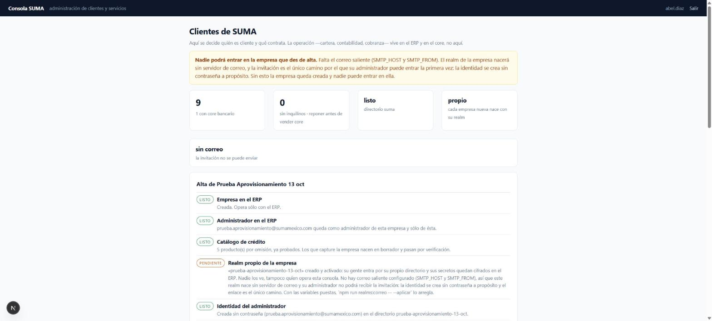
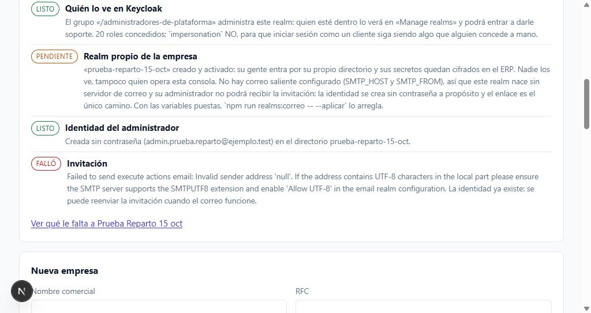
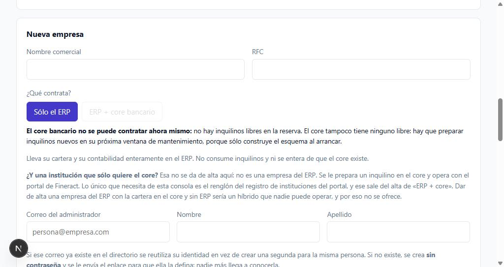
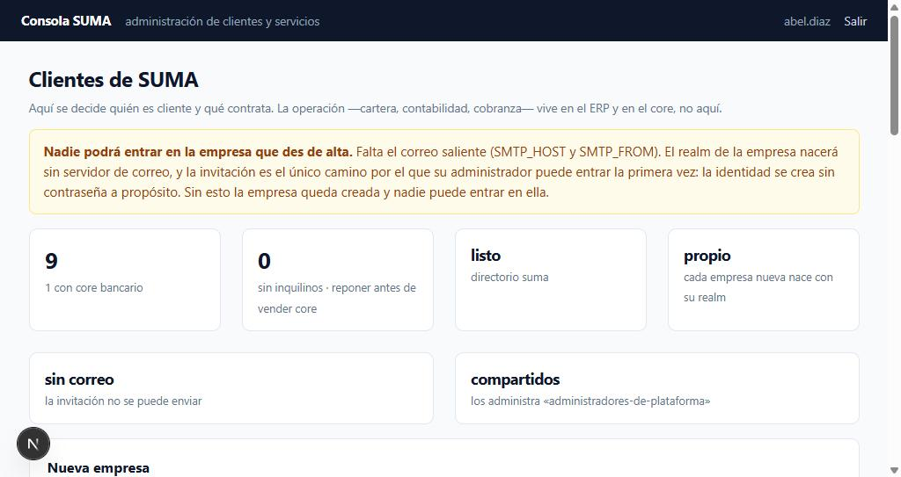
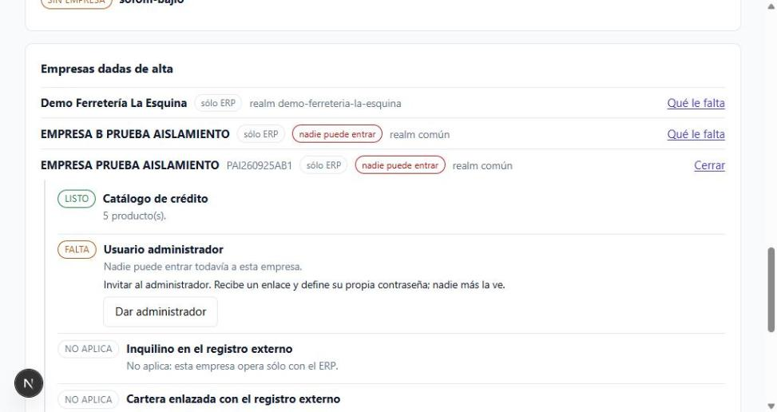

# 05 · Aprovisionamiento y consola SUMA

**Revisión:** 15 de octubre de 2026
**Para:** SUMA. Cómo se da de alta una empresa cliente.

> La consola es **una aplicación aparte, a propósito**, y vive en su propio
> repositorio (`erpfineract/suma-consola`), con su propia puesta en marcha en el
> `LEEME.md` de ahí. Este documento describe lo que hace y cómo se opera; la
> instalación de la consola no se duplica aquí.

---

## 1. Por qué está separada

El ERP y el portal de Fineract son herramientas con las que una empresa **opera**:
vende, cobra, lleva su cartera. La consola es la que decide **quién es cliente y
qué contrata**. Tenerlas juntas convierte a un inquilino del sistema en
administrador de los demás, y ninguna cantidad de roles arregla eso: la separación
tiene que ser de aplicación, de despliegue y de identidad.

Hubo dos intentos previos que no bastaban:

1. **Dentro del ERP**, protegida por un rol. Cualquier administrador de la empresa
   operadora podía dar de alta clientes. Y quien puede otorgarse el rol, puede
   aprovisionar.
2. **Dentro del portal de Fineract**, acotada por inquilino. Mejor, pero seguía
   siendo la aplicación con la que un cliente opera lo financiero.

La consola tiene además **su propio realm** (`suma-consola`), aparte del de las
instituciones: compartirlo significaría que una cuenta de operación comprometida
alcanza el aprovisionamiento. Sólo entra quien pertenece al grupo `operadores`.

---

## 2. La puerta contra el ERP

La consola habla con el ERP por las diez rutas `/aprovisionamiento/empresas/*`,
con la cabecera `x-aprovisionamiento`. La clave es la misma cadena en los dos
lados: `APROVISIONAMIENTO_TOKEN` en el ERP, `ERP_APROVISIONAMIENTO_TOKEN` en la
consola.

- Comparación en **tiempo constante**.
- Sin clave, o con menos de 32 caracteres, esas rutas responden **404**: parecen
  no existir.
- **Ninguna sesión de usuario del ERP las alcanza**, y hay una prueba de
  coherencia que lo exige.

---

## 3. Dar de alta una empresa

**Nueva empresa** — nombre comercial, RFC, qué contrata y el correo de su
administrador. El resultado **no dice «listo»**: dice **paso por paso** qué quedó
hecho y qué no, y cada paso sale como `listo`, `pendiente` o `falló` con su
detalle.

| Paso | Qué hace | Cuándo sale `pendiente` |
|---|---|---|
| **Empresa en el ERP** | Crea la empresa y su configuración de modos. | — |
| **Inquilino del core** | Le entrega un inquilino ya reservado, si contrató core. | Si la reserva está vacía. |
| **Catálogo de crédito** | Siembra los productos de crédito. | Si el ERP no pudo sembrarlos. |
| **Realm propio de la empresa** | §5. | Si falta la credencial de `master`. |
| **Administrador en el ERP** | Da de alta la cuenta del administrador. | — |
| **Identidad en el directorio** | Crea la identidad en Keycloak, **sin credencial** y con la acción de definirla. | — |
| **Invitación** | Manda el correo con el enlace. | Si el SMTP del realm rechaza. |

> **El catálogo de crédito fallaba en silencio**: la consola decía «LISTO ·
> Creada» y la empresa quedaba sin productos. Es la familia *silencio reportado
> como éxito*, y por eso ahora cada paso se declara por separado.

### Los tres modos

| Modo | Qué se le pide a la consola |
|---|---|
| **Sólo ERP** | Empresa, catálogo, administrador, realm propio. Sin inquilino. |
| **ERP + Fineract** | Todo lo anterior, más el inquilino del core **y el cliente `fineract-erp-portal` en su realm**, que es por donde la institución entra al portal. |
| **Sólo Fineract** | **No se da de alta desde aquí.** Una institución que no usa el ERP no es cliente del ERP: se le prepara un inquilino y opera con el portal. Darla de alta aquí creaba el híbrido imposible —cartera en el core y sin ERP que la mande—. |

> Esa explicación vivía sólo en la cabecera de una prueba del backend
> (`tres-modos-de-contratacion.spec.ts`), que es exactamente donde no la lee
> quien opera la consola. Desde el 13-oct-2026 está **en la consola**, debajo de
> los dos botones de «¿Qué contrata?».

#### Qué se puede dar de alta HOY (15-oct-2026)

| Modo | Estado |
|---|---|
| **Sólo ERP** | **Se aprovisiona de verdad, de punta a punta.** Medido el 15-oct con un alta completa (§3 ter): los siete pasos salen, el realm nace activado y **el reparto de visibilidad en Keycloak ya sale en verde**. Lo único que falla es la invitación, por el SMTP. |
| **ERP + Fineract** | **Bloqueado.** No hay inquilinos libres en la reserva y el core tampoco tiene ninguno: sólo construye el esquema al arrancar, así que hay que preparar inquilinos en una ventana de mantenimiento. Sus pantallas sí se prueban contra *SUMA Local*. |
| **Sólo Fineract** | No aplica (ver arriba). |

> **Las dos cosas que faltan son de operación, no de código**: el correo saliente
> y la ventana de mantenimiento del core. Sin la primera, una empresa recién
> dada de alta queda creada y **nadie puede entrar en ella** —la invitación es
> el único camino la primera vez, porque la identidad se crea sin contraseña a
> propósito—.

---

### El alta, paso por paso, en pantalla

El resultado no dice «listo»: dice qué quedó hecho y qué no, uno por uno.

---

## 3 bis. Quién ve el realm de una empresa

**MEDIDO el 13-oct-2026.** La consola creó un realm, Keycloak lo servía —su
`.well-known/openid-configuration` contestaba 200— y en «Manage realms» no
aparecía. Sólo salían `suma`, `suma-consola` y `master`.

No fallaba el alta. **«Manage realms» no lista los realms que existen: lista
aquellos sobre los que quien mira tiene `view-realm`.** Al crear un realm,
Keycloak crea en `master` un cliente `<realm>-realm` con los roles de su
administración y se los concede **a quien lo creó** —la cuenta de servicio de la
consola—. A nadie más.

> Consecuencia: cada empresa dada de alta nacía **invisible** para quien tiene
> que darle soporte. No se descubre probando el alta, que sale verde: se
> descubre el primer día que un cliente llama.

### Cómo queda

| | |
|---|---|
| **Quién administra** | Un **grupo de `master`**, en `KEYCLOAK_GRUPO_ADMINISTRADORES`. Un grupo y no una lista de personas: la pertenencia se administra una vez y vale para todos los realms, los de ayer y los de mañana. |
| **Qué se concede** | Todos los roles de `<realm>-realm` **menos `impersonation`**, que permite iniciar sesión *como* un cliente. Para soporte no hace falta, y concederlo por omisión convierte un permiso excepcional en el estado normal. `ROLES_ADMIN_REALM_EXTRA` deja cambiar de opinión, y entonces consta en el `.env`. |
| **Cuándo** | Un paso del alta, «Quién lo ve en Keycloak», después del registro en el ERP: si falla, el realm es bueno y la empresa opera. Es un pendiente de soporte, no un reparo. |
| **Los que ya existen** | `npm run realms:visibles -- --aplicar`. |
| **Lo que NO hace** | Crear el grupo ni meter a nadie dentro. Eso es decidir quién administra la plataforma, y no lo decide un alta. |

### Puesta en marcha, una vez

1. En Keycloak, realm `master` → **Groups** → crear `administradores-de-plataforma`.
2. **Members** → añadir a quienes dan soporte.
3. Conceder a la cuenta de servicio de la consola los **tres** roles del
   cliente `master-realm` (abajo).
4. `npm run realms:visibles -- --aplicar` para los realms ya creados.
5. Cerrar sesión y volver a entrar: los permisos viajan en el token.

### Los tres permisos, y por qué son tres

**MEDIDO el 13 y el 14-oct**, y costó dos vueltas con quien administra
Keycloak porque la primera lista estaba incompleta. El reparto hace tres cosas
distintas y cada una pide su permiso del cliente `master-realm`:

| Rol | Para qué | Si falta |
|---|---|---|
| `view-users` (o `query-groups`) | Encontrar el grupo por su ruta. | No sabe a quién conceder. |
| **`view-clients`** | Encontrar el cliente `<realm>-realm` y **leer sus roles**. | 403 al leer los roles: *éste fue el que faltó*. |
| `manage-users` | Escribir la concesión en el grupo. | 403 al aplicar. |

Más `create-realm` como rol de realm, que ya tenía de antes.

> **El tropiezo, para que no se repita:** con `view-users` y `manage-users`
> concedidos, el reparto fallaba con un 403 que no decía de qué. Faltaba
> `view-clients`, y el mensaje no lo nombraba porque el paso que fallaba era
> justo el que el doble de pruebas no sabía reventar —*una prueba que no
> puede fallar es peor que no tenerla*—. Hoy los dos 403 dicen su permiso por
> su nombre, el doble sabe fallar en ese paso, y el guión comprueba **los tres
> de golpe antes de intentar nada** y los lista todos juntos con la ruta
> exacta de Keycloak, para que una vuelta baste.

### Y se prueba, no se declara

`npm run realms:visibles` (sin `--aplicar`) es un ensayo: dice qué realms se
compartirían y cuáles ya lo están, y **no escribe nada**. La consola hace esa
misma comprobación sola al abrir —sólo con GET— y lo enseña en la tira de
indicadores: `compartidos`, `no se reparten` o `invisibles`. Antes esa casilla
se leía del `.env.local`, que es declarar.

**Medido el 14-oct tras conceder los tres:** 2 de 2 realms de empresa
compartidos, 20 roles cada uno, `impersonation` fuera.

> La cuenta de `master` traía además **19 roles de administración que el
> reparto no usa**, `impersonation` entre ellos. Recortarlos es una decisión
> de quien administra la plataforma, y está anotada como pendiente.

---

## 3 ter. El alta completa, medida el 15-oct-2026

Esta es la prueba que los dos días de permisos de Keycloak bloqueaban. Alta
real contra el Keycloak de producción, con la consola, el ERP y el core
encendidos.

| | |
|---|---|
| Nombre comercial | Prueba Reparto 15 oct |
| RFC | PRE261015AA1 |
| Qué contrata | **Sólo el ERP** (no hay inquilinos libres en la reserva) |
| Administrador | Prueba Reparto · `admin.prueba.reparto@ejemplo.test` |

| Paso | Resultado | Lo que dijo |
|---|---|---|
| Empresa en el ERP | **LISTO** | Creada. Opera sólo con el ERP. |
| Administrador en el ERP | **LISTO** | Queda como administrador de esta empresa y sólo de ésta. |
| Catálogo de crédito | **LISTO** | «5 productos por omisión». |
| **Quién lo ve en Keycloak** | **LISTO** | «El grupo `/administradores-de-plataforma` administra este realm… **20 roles concedidos; `impersonation` NO**». |
| Realm propio de la empresa | PENDIENTE | «prueba-reparto-15-oct» creado y activado. Pendiente **por el SMTP**, no por el realm. |
| Identidad del administrador | **LISTO** | Creada **sin contraseña** en el directorio `prueba-reparto-15-oct`. |
| Invitación | **FALLÓ** | `Invalid sender address 'null'`. La identidad existe: se puede reenviar cuando el correo funcione. |

**Lo único que falta para que un alta salga entera es el correo saliente.** No
es código: son dos variables (`SMTP_HOST`, `SMTP_FROM`) y, con ellas puestas,
`npm run realms:correo -- --aplicar` se lo pone a los realms ya creados.

> El paso del catálogo dice «5 productos por omisión» y no «5 producto(s)».
> Ese paréntesis fue lo que destapó, esa misma noche, que la frase no la
> escribía la consola: la escribe el ERP. Ver §9.

### El formulario dice lo que no se puede contratar, y por qué

«ERP + core bancario» sale **apagado con su razón al lado** —no hay inquilinos
libres y el core sólo construye el esquema al arrancar— en vez de dejarse
pulsar para contestar que no. Y la pregunta que siempre llega después —«¿y una
institución que sólo quiere el core?»— está contestada ahí mismo, que es donde
se hace.

---

## 4. La reserva de inquilinos del core

**Fineract sólo construye el esquema de un inquilino al arrancar**, así que
crearlos al vuelo obligaría a reiniciar el core con todas las empresas operando.
Se preparan **por lote, en mantenimiento**, y el alta toma uno ya listo.

La pantalla de **Reserva de inquilinos** los lee del registro del propio core y
los enseña con su estado:

| Estado | Qué significa |
|---|---|
| **libre** | Listo para entregarse a la siguiente empresa. |
| **de tal empresa** | Ya asignado, y se dice a cuál. |
| **sin anotar** | El core lo tiene, la reserva del ERP no. Se anota **de un clic**. |

**No hay nada que teclear.** Antes la reserva pedía escribir a mano el
identificador que el sistema ya sabía.

Y **«asignar un inquilino» era un consejo sin puerta**: el estado de una empresa
lo recomendaba y no existía forma de hacerlo. Hoy es un botón
(`POST /aprovisionamiento/empresas/:id/inquilino`) que toma uno libre con
`FOR UPDATE SKIP LOCKED` —dos operadores a la vez no se llevan el mismo—, lo
escribe conservando los demás parámetros del proveedor, y lo deja en la bitácora.

Si la reserva está vacía, la consola **lo dice con palabras** en vez de ofrecer un
botón que contesta que no: un inquilino lo construye el core al arrancar, y ahí no
hay botón que valga.

---

## 5. El realm por empresa

**Escrito, probado por unidad, y dormido hasta que exista la credencial.**

El alta le crea a la empresa su propio realm de un solo POST con la plantilla
versionada (`plantillas/realm-plantilla.json`): clientes, mapeador de grupos,
política de contraseñas, protección contra fuerza bruta. Después **vuelve a leer
lo que creó** —que los tres clientes existan, que sus secretos se lean, que la
cuenta de servicio tenga de verdad `manage-users`— y lo registra **cifrado** en el
ERP. Si algo no cuadra **no lo activa**: una identidad a medio armar que el ERP
acepte es peor que ninguna, porque abre la puerta sin que nadie sepa hasta dónde.

Que la plantilla esté versionada tiene un beneficio que no se ve: **todos los
realms nacen iguales**, en vez de depender de que quien lo crea se acuerde de
marcar las mismas casillas.

**Falta una sola cosa, y es manual una vez por instalación, no una por cliente:**
en Keycloak, un cliente de servicio en el realm `master` con el rol **`admin`**, y
sus datos en el `.env.local` de la consola.

> **`create-realm` a secas no basta**, y es el tropiezo más probable: en Keycloak
> crear un realm y administrarlo son permisos distintos. Un cliente con
> `create-realm` crea el realm y después no puede leer sus clientes ni sus
> secretos, así que el alta no podría registrarlo en el ERP. La consola **distingue
> los dos casos** —un 401/403 al leer no es lo mismo que un 404— y dice cuál es.

**Por qué esa llave vive en la consola y nunca en el ERP:** quien tiene
`create-realm` puede crear, borrar y reconfigurar cualquier realm de la
instalación, incluido el de la propia consola. Si acabara en la aplicación con la
que se vende y se cobra, una vulnerabilidad ahí alcanzaría el directorio entero. Y
no se puede automatizar: ningún sistema puede otorgarse a sí mismo el permiso de
crear realms.

**Sin esa credencial el alta funciona igual que hoy**: la empresa nace en el realm
común y el paso sale como *pendiente* diciendo qué falta. No se pinta de verde
nada que no se hizo.

Del lado del ERP, cada realm por empresa se guarda en `empresa_identidad` y la
estrategia JWT sólo acepta emisores registrados (ver `02-arquitectura.md` §3).

---

## 6. «Qué le falta» a cada empresa

Cada empresa dada de alta se abre y **dice qué le falta**, con el botón que
resuelve cada punto al lado:

| Punto | Acción automática |
|---|---|
| Catálogo de crédito sin sembrar | `SEMBRAR_CATALOGO` |
| Nadie puede entrar | `DAR_ADMINISTRADOR` |
| Sin inquilino del core | `ASIGNAR_INQUILINO` |
| La invitación no llegó | Reenviar |

Y **quién puede entrar viene por nombre** —cuenta, rol, si está activa, si tiene
acceso local— para poder reenviarle la invitación sin ir a buscarla a Keycloak.

> Esa lista existía en el ERP desde el principio y **ninguna pantalla la
> enseñaba**. Es la familia *un control que no se puede satisfacer*: un estado que
> el sistema sabe calcular y nadie puede resolver.

---

## 6 bis. El diagnóstico se intenta, no se declara

La consola abre con un diagnóstico de lo que le falta para funcionar: las
variables, el realm, el grupo, el mapeador de grupos, la pertenencia de tu
cuenta, el provisionador de identidades y el enlace con el ERP. Existe porque
montar todo eso son cinco pasos en una consola ajena y equivocarse en cualquiera
produce el mismo síntoma —«no puedo entrar»— sin decir cuál falló.

Hasta el 13-oct, **dos de esos puntos se declaraban desde el `.env.local`** en
vez de comprobarse, y de la credencial que crea los realms no había punto
ninguno. Un secreto rotado, un cliente al que nadie dio `create-realm` o un ERP
apagado dejaban la pantalla entera en verde, y el fallo aparecía a mitad del
alta de un cliente: con el realm ya creado, o con la empresa ya escrita a
medias. *Un control que se cree puesto.*

Ahora las dos credenciales de las que depende aprovisionar **se prueban de
verdad**, y ninguna de las dos llamadas cambia nada:

| Punto | Qué intenta | Qué distingue |
|---|---|---|
| **La consola puede crear realms** | Pide el token a `master` y lee sus roles | Sin configurar · Keycloak no responde · secreto rotado · entra pero **sin `create-realm`** |
| **Enlace con el ERP** | `GET /aprovisionamiento/empresas/reserva` con la clave de servicio | ERP apagado · **401/403** (las dos cadenas no coinciden) · **404** (el ERP no tiene `APROVISIONAMIENTO_TOKEN` y niega que las rutas existan) |

Los dos casos que más tiempo ahorran son los dos últimos de cada fila:

- **Entra pero no puede crear realms.** La credencial es válida y el token no
  trae `create-realm`. Se arregla en Keycloak → realm `master` → Clients → el
  cliente → **Service accounts roles** → Assign role → `create-realm`. Es el
  único permiso que hace falta: Keycloak concede al creador la administración
  del realm que crea, así que esa llave no alcanza a los realms que no creó.

- **El ERP contesta 404.** No es que la ruta no exista: es que el ERP **niega
  que exista** cuando no tiene `APROVISIONAMIENTO_TOKEN` configurada, que es el
  estado correcto para una instalación sin consola. Se declara la variable en el
  ERP con la misma cadena que `ERP_APROVISIONAMIENTO_TOKEN` de la consola, y se
  reinicia.

**Corre el diagnóstico antes de necesitarlo.** Es gratis, no crea nada, y es la
diferencia entre enterarte ahora o a mitad del alta de un cliente.

### La tira de indicadores: lo que hay que saber antes de dar de alta

Seis casillas, y ninguna es decorativa: cada una responde una pregunta que de
otro modo se contesta a mitad de un alta.

| Casilla | Qué dice | Por qué está |
|---|---|---|
| **Empresas** | Cuántas hay y cuántas con core bancario. | — |
| **Inquilinos libres** | «0 · sin inquilinos — reponer antes de vender core». | Es la que apaga el botón de «ERP + core». |
| **Directorio** | Que el realm de las instituciones responde. | — |
| **Realm por empresa** | «propio · cada empresa nueva nace con su realm». | — |
| **Correo** | «sin correo · la invitación no se puede enviar». | **Nadie podrá entrar en la empresa que des de alta.** Por eso además sale en grande arriba, antes del formulario, y no como un pendiente al final. |
| **Reparto** | «compartidos · los administra `administradores-de-plataforma`». | Probado con GET, no leído del `.env` (§3 bis). |

> El aviso del correo está **arriba y antes del formulario** a propósito. Un
> aviso que sale después de pulsar «Dar de alta» informa de algo que ya no se
> puede evitar.

### Realms sin empresa

Un realm que esta consola administra y que **no corresponde a ninguna empresa
de la lista**. Puede ser un alta que no terminó, una empresa borrada del ERP o
un realm creado a mano. Tiene identidades dentro y **nadie responde por él**:
nadie lo revisa, nadie lo da de baja y nadie sabe quién puede entrar.

Es la contraparte de §3 bis. Allí el defecto era un realm que existe y nadie
ve; aquí es un realm que se ve y nadie reclama. Las dos listas juntas son las
que cuadran: cada realm con su empresa, cada empresa con su realm.

**Medido el 15-oct:** uno, `sofom-bajio`. Decidir si es un cliente de verdad o
un resto de pruebas está pendiente de SUMA.

### «Qué le falta», abierto

Cada punto sale como **listo**, **falta** o **no aplica**, y el que falta trae
el botón que lo resuelve al lado. «No aplica» se dice con todas sus letras —y
no se esconde— porque una empresa que opera sólo con el ERP tiene que poder
distinguirse de una a la que le falta el inquilino.

---

## 7. Lo que la consola NO hace, y por qué

**No fija contraseñas.** La identidad se crea sin credencial y con la acción de
definirla; la persona la elige por un enlace. Una contraseña que alguien teclea
por otro es una contraseña que viaja por correo o por chat y que después nadie
sabe quién vio.

**No crea inquilinos en el core.** §4.

**No hace operación.** Ni cartera, ni clientes finales, ni créditos, ni
contabilidad. Si algún día se propone agregar «un reportito de cartera porque es
cómodo», ése es el momento de decir que no.

---

## 8. Pendientes de la consola

- El **registro de instituciones** sigue siendo un archivo con secretos dentro.
  Debe guardar una *referencia* al secreto, nunca su valor: así rotarlo es una
  operación del gestor de secretos y no una escritura desde la web. Después, de
  archivo a tabla.
- **El SMTP del realm rechaza credenciales**: las invitaciones fallan hasta
  arreglarlo. La identidad queda creada igual y se puede reenviar.
- **`private_key_jwt`** en vez de secreto compartido, como mejora posterior.
- Recortar los **19 roles de administración de `master`** que el reparto no
  usa, `impersonation` el primero (§3 bis).
- Decidir si **`sofom-bajio`** es un cliente o un resto de pruebas (§6 bis), y
  si los realms de infraestructura —`suma`, `suma-consola`— deben compartirse
  también con el grupo de soporte.
- ~~El **realm por empresa** no se ha ejercitado contra un Keycloak vivo~~
  **Hecho el 13-oct y repetido de punta a punta el 15-oct** (§3 ter).

---

## 9. Lo que la consola destapó en el ERP

Vale la pena anotarlo porque va a repetirse: **la consola enseña texto que no
escribe**. El 15-oct, abriendo «Qué le falta» de una empresa, el renglón del
catálogo decía «5 producto(s)».

La consola ya tenía su pieza para decidir el plural y su prueba que lo vigila;
el portal de Fineract también. Las dos pantallas estaban limpias. Pero esa
frase la escribe el ERP, y las pantallas la enseñan tal cual: la regla estaba
puesta en los dos sitios donde se **lee** y faltaba en el único donde se
**escribe**.

El barrido del ERP encontró 112 frases así —86 en el servidor y 26 en las
pantallas—. La peor no era un registro de servicio: era el correo de cobranza
a un cliente final, que le decía «tu pago venció hace 1 día(s)».

> Para la próxima: cuando una pantalla de la consola se vea mal, la primera
> pregunta es **quién escribe esa frase**. Arreglarla donde se lee deja el
> defecto entero en pie y además lo esconde, porque la pantalla se ve bien.
