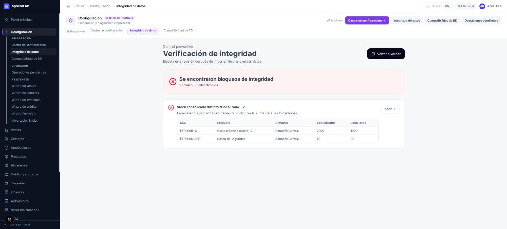

# 06 · Límites conocidos

**Revisión:** 13 de octubre de 2026

> Esta es la parte del conjunto que más vale. Una lista de verdes no dice nada si
> no va acompañada de lo que **no** se ha mirado y por qué. Aquí está todo en un
> solo sitio, para que nadie tenga que deducirlo del silencio de los otros
> documentos.

---

## 1. Los dos grandes pendientes

### 1.1 Timbrado CFDI

**No hay PAC real conectado.** El ciclo llega hasta *preparar* los comprobantes;
el timbrado es lo único que nadie ha visto funcionar de punta a punta, ni en
facturación ni en nómina.

Además, falta cargar la **ClaveProdServ** y la **ClaveUnidad** del SAT a los
productos. Son datos fiscales de negocio y los define el cliente. Sin ellos no se
puede facturar nada, y es lo único que separa al centro de configuración del
100 %.

### 1.2 Realm por empresa

Escrito, probado por unidad y **dormido**. Falta una credencial manual —una vez
por instalación, no una por cliente— y no se ha ejercitado contra un Keycloak
vivo: la plantilla se valida como JSON en las pruebas, y la comprobación
posterior existe justamente porque un import puede aceptarse a medias.

Detalle completo en `05-aprovisionamiento-y-consola-suma.md` §5.

**Decisión pendiente asociada:** un ERP instalado por cliente, o un ERP compartido
que necesite una pantalla de resolución de realm. El dato para lo segundo ya
existe (`dominiosPermitidos`); la decisión no está tomada.

---

## 2. Lo que no se pudo probar, y por qué

| Qué | Por qué no |
|---|---|
| **Las 85 pantallas del portal de Fineract con sesión** | El acceso es OIDC. Su capa de permisos sí está verificada entera —449 funciones de ruta, 437 con guarda, 12 excepciones declaradas una por una— y sus pruebas pasan. El recorrido sin sesión sí se hizo: el portal responde, y su página de «no existe» se comporta bien en vez de parecer una avería. |
| **El cierre de septiembre** | Ya se puede hacer: el mes terminó. Agosto se cerró y fue el primer cierre en la historia del sistema; septiembre sigue abierto y es el siguiente a ejercitar. |
| **El menú lateral completo con el plan apagado** | Apagarlo de verdad exige `PATCH /integracion/configuracion`, que es del administrador, y el menú resuelve el plan al cargar la página. **Sí quedó verificado en vivo** el centro de trabajo con el plan apagado: deja fuera «Flujo de verificación» y «Avisos del core» y conserva el resto. Falta la foto del menú entero; la puede dar SUMA cambiando el plan de una empresa de prueba. |
| **El alta ERP + core en vivo con una empresa nueva** | A propósito: el core sólo conoce un inquilino, `default`, y su dueño natural es la empresa principal. Gastarlo en una empresa de prueba habría sido definitivo. El camino quedó fijado por prueba y el paso final —entregar el inquilino— se ejecutó en vivo sobre la empresa correcta. |
| **`CONCILIACION_CARTERA` con diferencias reales** | Esta instalación tiene cero diferencias abiertas; habría que inventar una para verla en amarillo. |
| **La carrera del doble clic en «recibir mercancía»** | Es lo que cierra el índice único nuevo. Reproducirla exige dos peticiones simultáneas de verdad. |
| **Reenviar invitación y sembrar catálogo desde la consola** | No hay ninguna empresa en ese estado. |
| **El SMTP del realm** | Rechaza credenciales; las invitaciones fallan hasta arreglarlo. La identidad queda creada igual. |
| **El arqueo de caja por pantalla con el rol de tesorería, y las pólizas con el de contabilidad** | Lo que falta medir ahí es **qué ofrece la pantalla** a ese rol, y eso un guion no lo mide: hay que verlo. La vía existe —«ver el ERP como otro», §4 de `03-manual-por-rol.md`— y no se ha recorrido entera. |

---

## 3. Circuitos del ERP que todavía no se han ejercitado

Ordenados por lo que más se usa el día uno:

1. ~~Devoluciones de venta.~~ **Recorrida** (ver `07-flujos-y-procesos.md` §2).
2. ~~Conteos físicos de inventario y ajustes (WMS).~~ **Recorrido**, con las
   reglas de valuación y la negativa por cuatro ojos (§5).
3. ~~Depreciación de activos fijos.~~ **Recorrida de punta a punta, incluida la
   reversa** (§15). Queda un conteo abierto: `CNT-20261012224356-57F675`, que
   sólo puede cerrar alguien distinto de quien lo capturó.
4. ~~RRHH: incidencias y vacaciones.~~ **Recorridas** (§7 y §8): falta de tres
   días con su efecto en nómina, solicitud de vacaciones con el desglose de
   laborables, y las dos negativas por cuatro ojos.
5. ~~CRM de punta a punta: prospecto → oportunidad → venta ganada.~~
   **Recorrido** (§17): prospecto con la regla de contacto, oportunidad por las
   cinco etapas con el pronóstico ponderado cuadrando en cada una, cierre en
   Ganada y el paso a cliente. Falta ejercitar **Perdida** y las **Actividades**
   de seguimiento.
6. ~~Compras: cotizaciones y adjudicación~~ **Leída** sobre REQ-2026-000001, con
   dos ofertas compitiendo, la descartada marcada y la orden de compra generada
   (§16). **No se ha capturado una cotización nueva de principio a fin**: las dos
   requisiciones vivas esperan la firma de otra persona, que es justo lo que la
   segregación exige.

   Y una limitación que salió al leerla, en la tabla de abajo: **la adjudicación
   es por proveedor completo, no por partida**.

7. **Las 85 pantallas del portal de Fineract.** Recorridas por pantalla: Mi
   jornada, Cartera y originación, Mesa de control, **Cartera vencida** y
   **Riesgo y provisiones** —estas dos documentadas con capturas en
   `08-fineract-portal.md` §8, con las tres cuentas verificadas contra el
   renglón—. El resto, pendiente.

   Una cosa que **no** se tocó, a propósito: el portal escribe sus conteos con
   el paréntesis —«5 producto(s)», «28 solicitud(es)»—, que es la forma que el
   ERP acaba de abandonar por `plural()`. Aquí no es un defecto: «0
   producto(s)» se lee bien con cualquier número, mientras que el «1 registros»
   del ERP estaba mal. Y dos pruebas del portal fijan esas cadenas, su suite no
   corre fuera de Windows, y son 19 archivos. Cambiar lo que no se puede probar,
   por una mejora cosmética, no sale a cuenta — queda anotado para cuando haya
   con qué verificarlo.

---

## 4. Funciones que faltan

| Qué | Nota |
|---|---|
| **Reversa de pagos a proveedor** | El ERP no la tiene, y por eso el movimiento de tesorería de un pago no se puede cancelar (ver `03-manual-por-rol.md`). `CobranzaService.cancelarPago` es la plantilla natural, pero toca tesorería, turno de caja, póliza e IVA reclasificado. |
| **Umbrales por monto en compras** | Implementados, sin configurar. Hoy toda requisición sube al mando. Los números los pone el cliente. |
| **Un hallazgo que dice *cuáles*, no *cuántas*** | El hallazgo de «cuentas con saldo contrario» dice cuántas y manda a revisar la balanza. Con cuatro entre cientos, es hacerle al contador el trabajo que el sistema ya hizo. |
| **Adjudicar por partida** | La comparación de cotizaciones adjudica a **un** proveedor la requisición entera. En REQ-2026-000001 ganó Ferretera del Bajío por el total ($96,152.40 contra $97,672.00), y aun así el otro proveedor era más barato en tres de las cinco partidas —casco, azúcar y café—. Repartir la orden entre proveedores por renglón es lo que haría un comprador con esos dos PDF delante, y hoy hay que hacerlo a mano creando dos requisiciones. |
| ~~Ubicar lo que quedó sin ubicar~~ | **Ya existe**: Almacenes → Reubicaciones, sección «Existencias sin posición». Esta tabla la daba por ausente; ver §4bis. |

---

## 4bis. La pieza que metía una devolución

**Esto estaba escrito como una decisión pendiente y resultó ser un defecto.**
Queda aquí la historia completa porque explica tres cosas que parecían
distintas.

### El síntoma

El apartado de un pedido de venta se decide con el **resumen del almacén** y la
salida de la venta se sirve de las **posiciones**. El 12 de octubre el resumen
decía 99 piezas de `FER-CAS-SEG` y las posiciones 98, así que el pedido apartó
99 y el surtido se negó:

> «Stock insuficiente no reservado. Faltan 1 unidades.»

Durante seis días se creyó que esa pieza la había movido alguien a mano.

### La causa

El kardex del producto lo decía:

```
30/9  ENTRADA  +100  Recepción OC        → 100
30/9  SALIDA     1   Ticket #1           →  99
6/10  SALIDA     1   Ticket #2           →  98
6/10  ENTRADA   +1   Devolución DEV-1    →  99
```

**La pieza la metió una devolución.** El 8 de octubre se cerró que toda entrada
cayera en una posición —el andén de recepción—, pero ese arreglo se escribió
dentro de `registrarCompra`, y la devolución de venta **no pasa por ahí**:
escribe el lote, escribe el movimiento y sincroniza el resumen, por un motivo
legítimo —necesita recuperar el costo original de cada salida, y
`registrarCompra` calcularía un promedio nuevo—. Nunca tocaba
`stock_ubicaciones`.

La **anulación de venta** hacía exactamente lo mismo.

Se comprobó haciendo una devolución nueva por pantalla, DEV-2 del 12 de
octubre: contabilidad impecable —dos pólizas cuadradas del día— y el cable
quedó con 2000 en el resumen y 1999 localizadas.

### Lo que el sistema sí estaba diciendo

La verificación de integridad lo nombraba, con SKU, almacén y las dos cifras.
Nadie la miró.



### Lo que se hizo

«Dónde cae una entrada» salió de `registrarCompra` a una pieza propia
—`catalogo/utils/una-entrada-cae-en-una-posicion.ts`— y ahora la usan las tres
vías que suben existencia: la recepción, la devolución y la anulación. Lo
devuelto va al **andén de recepción** y no a la posición de donde salió: lo que
vuelve llega al mostrador y alguien tiene que mirarlo antes de guardarlo.

El barrido que vigilaba esto miraba **los llamadores de `registrarCompra`**, así
que no podía ver una vía que no lo llama. Ahora mira lo que de verdad define una
entrada: **quién sube `stockRestante`**. Son tres archivos, están declarados uno
por uno, y el día que nazca un cuarto la prueba lo nombra.

### Lo que queda, y cómo se arregla

**Dos piezas sueltas en SUMA Local** —una de `FER-CAS-SEG` y una de
`FER-CAB-12`, las dos en Almacén Central—. Existen de verdad: el kardex tiene
razón. Lo que falta es ponerlas en una posición.

**Y para eso sí hay pantalla**: **Almacenes → Reubicaciones**. Abajo tiene
«Existencias sin posición», con el producto, el almacén, lo que dice el almacén,
lo que está ubicado y la diferencia, y un botón **Ubicar** por renglón que
rellena la cantidad. Colocar una existencia sin posición **no cambia ningún
total y no genera póliza**: la mercancía ya está en el almacén y ya está
valuada; lo único que cambia es dónde dice el sistema que está.

> Esta nota decía, hasta el 12 de octubre, que «no hay pantalla para eso».
> Era falso, y es el defecto de documentación que más caro sale: **un manual
> que afirma un hueco que no existe hace que nadie use la herramienta que sí
> está.** La pantalla se construyó con su propio porqué —un detector sin
> remedio, que avisa de algo que nadie puede arreglar, se acaba ignorando—.

**Lo que NO sirve para esto es un conteo físico, y además lo empeora.** La hoja
de conteo se arma con lo que hay en las posiciones: diría 98 donde el almacén
cree tener 99, el almacenista contaría las 99 que están ahí, y el sobrante de
+1 dejaría el total del almacén en 100.

Mientras no se coloquen, la verificación de integridad sigue en rojo y un pedido
sobre esos dos artículos puede prometer una pieza que la salida no encuentra.

---

## 4ter. El manual del portal lo publica el ERP

`08-fineract-portal.md` se sirve desde la pantalla de **Ayuda del ERP**, porque
esta instalación lleva los dos sistemas y el ERP ya tiene el publicador —con su
control de quién ve qué, su índice y su PDF—.

**Una institución que compre sólo Fineract no tendría dónde leerlo.** El portal
no tiene pantalla de documentación. Las dos salidas:

- **(a)** Darle al portal su propia pantalla de documentación. Es correcto y
  cuesta duplicar el renderizador de Markdown, que es justo lo que este proyecto
  evita: dos copias del mismo código divergen.
- **(b)** Sacar el renderizador a una pieza compartida entre los dos
  despliegues. Más limpio y más trabajo.

Mientras no se decida, el manual del portal existe y se lee —desde el ERP— en
los dos modos que SUMA vende hoy. En el modo de sólo Fineract, no.

---

## 5. Decisiones abiertas

| # | Qué hay que decidir |
|---|---|
| A | **Cuentas con saldo contrario.** Hay cuentas de prueba sobregiradas. Decidir cuáles van a existir de verdad. |
| B | **Quién firma la REQUISICION de Compras.** Hoy la matriz apunta a contabilidad, y autorizar la necesidad de compra es la función equivocada; pero quién firme es del organigrama del cliente. |
| C | **`capacidadesValidacion: []`.** Con la lista vacía se esconde «Flujo de verificación» entera, pero tres de sus siete pasos no consultan a nadie. ¿Se esconde, o se deja con los pasos internos? |
| D | **~35 pares rol/pantalla** donde la pantalla abre y una lectura suya da 403. Triaje pendiente. Tres de ellos ya se cerraron —las consultas de política de crédito, saldo a favor y lista de precios del mostrador— y el patrón que los delató quedó como prueba, así que el resto se puede recorrer con ella. |
| E | **`AUTH_MODE=local`.** Si Keycloak es obligatorio, debería retirarse por completo: la rama HS256 de la estrategia JWT, el flujo de invitación local y su validación de entorno. Mientras exista, es una segunda puerta que nadie mantiene. |
| F | **Los registros de auditoría anteriores al 25-sep-2026** quedaron sin encadenar. Ver `01-instalacion-y-puesta-en-marcha.md` §7. |
| G | **La duración de la sesión en Keycloak.** El token de acceso vive sesenta minutos, y la renovación automática ya funciona y está probada. Falta decidir *SSO Session Idle* y *SSO Session Max* del realm `suma`: son los que deciden cuándo se acaba la sesión aunque la persona siga trabajando. |
| H | **El realm `suma` en español.** La pantalla de Keycloak sale en inglés y el botón dice «Iniciar sesion con Microsoft», sin acento. Es lo primero que ve cualquiera. |

---

## 6. Antes de producción

Dos cosas que no son decisiones sino comprobaciones, y que conviene hacer el
mismo día del despliegue:

- **`NODE_ENV=production`.** De eso depende, entre otras cosas, que «ver el ERP
  como otro» quede apagado: tiene tres candados —entorno distinto de producción,
  `SUPLANTACION_HABILITADA=true` puesto a mano, y rol de administrador— y el
  primero basta para cerrarlo. No hay que apagar nada: hay que comprobar que el
  entorno dice lo que debe.
- **El navegador del PDF.** La documentación se descarga en PDF desde el propio
  ERP, y para eso el servidor necesita un navegador. Ya no hay que adivinar si lo
  encuentra: `npm run documentacion:pdf` lo dice —qué navegador eligió y si los
  siete documentos salieron— y termina en rojo si alguno no sale. Si falta,
  `npx puppeteer browsers install chrome` o la ruta de uno instalado en
  `DOCUMENTACION_NAVEGADOR`.

Lo demás de la puesta en marcha está en
`LISTA-ANTES-DE-PRODUCCION-configuracion`.

---

## 7. Deuda estructural

- **Las carpetas `syncro-erp-backend` y `syncro-erp-frontend`** están congeladas
  desde el 10 de septiembre y no ejecutan nada. Conviene retirarlas: ya costaron
  horas de trabajo sobre el árbol equivocado.
- **El repositorio `suma-consola` tiene el árbol de trabajo en CRLF y el contenido
  commiteado en LF, en todos los archivos.** Cada archivo que se toque arrastra su
  diff entero. Pide un `.gitattributes`.
- **La prueba del PDF acepta sus dos finales.** Bajo jest siempre toma el de
  error, porque puppeteer es sólo ESM y el transformador de jest no lo carga; en
  node corriente sí funciona. Mientras esa prueba siga pasando por la rama de la
  disculpa, quien comprueba el PDF de verdad es `npm run documentacion:pdf`, no
  `npm test`. Es el mismo patrón que la resolución del navegador, que durante
  meses tuvo una rama que no se tomaba nunca sin que nadie lo notara.
