# 07 · Flujos y procesos, paso a paso

**Revisión:** 13 de octubre de 2026
**Para:** usuarios finales, quien los capacita y quien recibe el sistema.

> Cada flujo de este documento está **ejercido contra el sistema corriendo o
> leído del código que se despliega**. Los mensajes que aparecen entre comillas
> son literalmente los que verás en pantalla.

**Compras y nómina tienen su propio manual**, en `04-compras-y-nomina.md`.
**El alcance de cada rol** está en `03-manual-por-rol.md`.

---

## Cómo leer este documento

Cada proceso se cuenta igual:

- **Quién lo empieza** y desde qué pantalla.
- **Los pasos**, con el estado en que queda el documento después de cada uno.
- **Quién firma**, cuando hace falta una segunda persona.
- **Qué te va a negar el sistema**, con el texto exacto y el motivo.

Esa última sección es la que más se usa en el día a día. Un ERP no se aprende
por lo que deja hacer, sino por lo que no deja y por qué.

### Una regla que atraviesa todo el sistema

**Quien captura no autoriza.** Aparece en ocho lugares distintos y siempre
significa lo mismo: la persona que registra un documento no puede ser la que lo
firma. No es rigidez; es lo que hace que una firma valga algo.

Cuando el sistema te lo dice, no estás ante un error de permisos: estás ante un
control funcionando. La respuesta correcta nunca es pedir más permisos, sino
que firme quien le toca.

Y lo que espera una firma no se queda escondido en el documento: está todo junto
en **Aprobaciones**, la bandeja central.

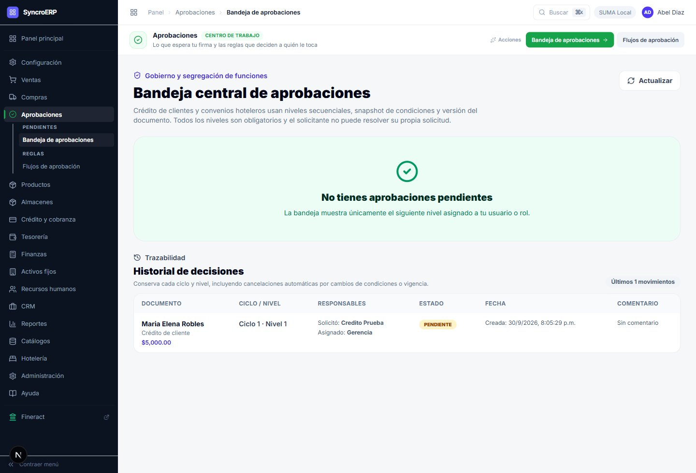

---

# 1 · Vender en mostrador

**Quién:** `empleado`. **Dónde:** Punto de venta.

## Los pasos

| # | Qué pasa | Estado de la venta |
|---|---|---|
| 1 | Eliges la caja donde vas a cobrar | — |
| 2 | Agregas productos al carrito | — |
| 3 | Eliges método de pago y cobras | **COMPLETADA** |

La venta **nace completada**. No hay borrador ni pendiente: o se cobró o no
existe.

## La caja se abre en su propia ventana

El punto de venta **ya no vive dentro del área de trabajo**: se abre aparte, a
pantalla completa y sin menús. Entrar a «Punto de venta» desde el menú no te
pone a cobrar, te ofrece abrirla.

Es deliberado: cobrar no comparte sitio con la administración. Quien está en el
mostrador no tiene a un clic el catálogo de cuentas ni la nómina, y la pantalla
de cobro no pierde la mitad del ancho en un menú que ahí no se usa.

## Lo que la caja decide por ti

Al elegir la caja quedan fijados **el almacén de donde sale la mercancía y la
lista de precios** con la que vendes. No son campos que el cajero escoja.

Es deliberado: quien vende no decide desde qué almacén se descuenta ni a qué
precio se factura. Si cambias de caja con el carrito lleno y esa caja vende
desde otro almacén o con otra lista, el sistema te lo dice:

> «Vacía el carrito antes de cambiar de caja: ésta vende desde otro almacén o
> con otra lista de precios, y el stock y los precios ya fueron confirmados.»

## Lo que pasa solo al cobrar

- Se **descuenta la existencia** del almacén de la caja, por lote y con su costo.
- Se registra el **movimiento de tesorería** y, si la cuenta es una caja, el
  **movimiento de caja**.
- Se **encola la póliza contable**. Si la contabilidad no puede generarse en ese
  momento, la venta igual se cobra y el asiento queda en
  **Finanzas → Asientos pendientes**. Nunca se pierde una venta por un problema
  contable.
- Si la venta es a crédito, nacen el **crédito y su tabla de amortización** en la
  misma operación.
- Y **sale el ticket**, si la caja tiene impresora declarada. Ver abajo.

## El ticket

Al terminar la venta, el servidor manda el ticket a la impresora térmica de esa
caja. No hay que pulsar nada, y no hay que instalar nada en el mostrador: la
impresora tiene su dirección en la red y el servidor le escribe directamente.

Qué impresora le toca a cada caja se declara en
**Tesorería → Impresoras de ticket**, y hay un botón **Probar impresora** que
manda una página de prueba: la alternativa es configurarla y descubrir el error
con el primer cliente enfrente.

Tres formas de imprimir, y las tres son legítimas:

| Modo | Cuándo | Qué hace el punto de venta |
|---|---|---|
| **Por red** | La impresora tiene su propia IP | El ticket sale solo al cobrar |
| **Desde el navegador** | La impresora cuelga por USB de la computadora de la caja | Abre el ticket; se imprime con el diálogo de siempre |
| **No imprimir** | Un mostrador que sólo factura por correo | Nada |

Una caja **sin configurar** se comporta como «desde el navegador», que es como
funcionaba antes: nadie se queda sin comprobante por no haber declarado nada.

Tres cosas que conviene saber:

- **Si el ticket no sale, la venta está cobrada igual.** La pantalla lo dice en
  ámbar, con el motivo —impresora apagada, sin red, sin papel— y recuerda que
  puedes abrir el ticket e imprimirlo desde el navegador. Un problema de papel
  nunca tumba un cobro.
- **La segunda copia sale marcada «REIMPRESIÓN».** Un ticket reimpreso que no se
  distingue del original sirve para cobrar dos veces una devolución.
- **El cajón de dinero se abre sólo con efectivo**, y sólo si se pidió al
  configurar. Un cajón que se abre con cada tarjeta acaba quedándose abierto.

El ticket **no es un comprobante fiscal**, y el papel lo dice, para que la
discusión no ocurra en el mostrador.

## Qué te va a negar el sistema

| Si intentas… | Te dirá | Por qué |
|---|---|---|
| Cobrar en efectivo sin abrir caja | «No existe un turno abierto para la caja seleccionada. Abre la caja antes de cobrar o reembolsar efectivo.» | El efectivo tiene que caber en un arqueo |
| Cobrar más de lo que hay | «Disponibilidad insuficiente. Física: …, reservada: …, bloqueada: …» | Te dice **por qué** no alcanza, no sólo que no alcanza |
| Vender un producto sin precio | «… no tiene precio en la lista aplicable. En este ERP el precio de venta vive en las listas de precios» | El precio no se teclea en la venta |
| Recibir menos efectivo que el total | «El monto recibido debe cubrir …» | — |
| Vender a crédito sin cliente | «Una venta a crédito requiere seleccionar un cliente.» | No hay crédito sin a quién cobrarle |
| Pasarte del crédito del cliente | «Crédito global insuficiente. Disponible: …; solicitado: …» | Con la cifra, para que sepas cuánto falta |
| Aplicar un descuento | «… no se puede aplicar. Tu perfil no tiene descuento autorizado. En este ERP el precio de venta lo fijan las listas de precio…» | El descuento no se autoriza en el mostrador |

---

# 2 · Devolver una venta

**Quién la captura:** `empleado`. **Quién la firma a partir de $5,000:**
`gerencia` o `direccion`.

## Los pasos

1. Abres la venta y eliges qué renglones se devuelven y cuántas piezas.
2. Dices **en qué condición vuelve** cada producto:
   - **reintegrable** — vuelve a su lote y a su costo original;
   - **dañado** — entra y sale por merma, para que quede el rastro;
   - **no reintegrable** — no toca existencias, sólo el importe.
3. Eliges el **destino del importe**: reembolso, o saldo a favor del cliente.
4. La venta queda **PARCIALMENTE_DEVUELTA** o **DEVUELTA**.

## Dónde queda la mercancía que regresa

Lo devuelto en condición **«Regresa a existencia»** vuelve a su lote original
—con el costo con el que salió, no con uno nuevo— y se guarda en el **andén de
recepción** del almacén, no en la posición de donde salió.

Es a propósito: lo que vuelve llega al mostrador y alguien tiene que mirarlo
antes de guardarlo. Queda localizado desde el primer segundo y el almacén lo
reubica, que es para lo que existe esa pantalla.

Lo devuelto como **dañado** no vuelve a existencia: entra y sale en el mismo
acto, y queda como merma con su costo.

## Qué te va a negar el sistema

| Si intentas… | Te dirá |
|---|---|
| Devolver después de 30 días | «La venta tiene N días y la política permite devoluciones hasta 30 días.» |
| Devolver en un mes ya cerrado | «El periodo contable MM/AAAA está cerrado. No se puede registrar la devolución.» |
| Devolver más de lo vendido | «…: sólo quedan N unidades disponibles para devolver.» |
| Reembolsar en efectivo desde un banco | «Un reembolso en efectivo debe salir de una cuenta de tipo CAJA.» |
| Devolver $5,000 o más sin ser gerencia | «La devolución por $… requiere autorización de supervisor porque supera el umbral de $5,000.» |
| Devolver a existencia algo cuya salida no identifica lote | «…: la salida histórica no identifica lote. Usa "No reintegrable" o regulariza el movimiento…» |

> **El umbral se configura.** `DEVOLUCIONES_MONTO_APROBACION` cambia la cifra y
> `DEVOLUCIONES_ROLES_AUTORIZADORES` quién puede firmarla.

## Si la venta estaba facturada

La nota de crédito se genera sola. Si el PAC falla, la devolución **igual se
registra** y queda pendiente de timbrar, con aviso:

> «La devolución fue confirmada; la nota de crédito quedó pendiente para
> reintento desde Facturación.»

---

# 3 · Anular una venta

**Quién:** sólo `gerencia`, `direccion` o el administrador. **Por cualquier
importe.**

El umbral de anulación es **cero a propósito**: anular elimina la venta entera,
y eso no está al alcance de un cajero por ningún monto. Un cajero que se
equivocó hace una **devolución**, no una anulación.

## Qué te va a negar el sistema

Anular está lleno de puertas cerradas, y todas por la misma razón: **si la venta
ya movió dinero de otro, anularla dejaría un descuadre.**

| Si intentas… | Te dirá |
|---|---|
| Anular sin motivo | «Indica el motivo de la anulación. Queda en la bitácora y en la póliza de reversión.» |
| Anular una venta con devoluciones parciales | «…Devuelve el remanente desde el módulo de devoluciones; no puede anularse completa.» |
| Anular una venta a crédito ya liquidada | «…Anular dejaría un pago sin documento que lo respalde.» |
| Anular una venta a crédito con enganche o abonos | «…Debe procesarse como devolución con reembolso para no dejar CxC, caja e IVA inconsistentes.» |
| Anular una venta anterior al costeo por lote | «…no existe registro de a qué lote ni a qué costo salió la mercancía, así que el sistema no puede reintegrarla sin corromper la valuación.» |

Ese último mensaje además **te dice qué hacer**: registrar la entrada a mano
desde Inventario → Ajustes y después anular, o procesar una devolución
indicando el lote.

## Una puerta que se abrió, y por qué se podía abrir

**Hasta el 5 de octubre de 2026, una venta pagada en parte con saldo a favor del
cliente no se podía anular.** El sistema decía:

> «Anularla dejaría ese saldo sin restituir y la cuenta de cobro descuadrada.
> Regístralo como devolución total.»

Y tenía razón **para el código que había**: la póliza de reversión se calculaba
de nuevo en vez de contrarrestar la de la venta, así que no sabía del saldo a
favor y abonaba el total a la cuenta de cobro. El pasivo con el cliente quedaba
sin cancelar.

Hoy la reversión **espeja la póliza original** —devuelve cada peso a la cuenta de
la que salió— y además el saldo vuelve al auxiliar del cliente, que es el que
dice cuánto le queda. Hechas las dos mitades, el motivo del bloqueo desapareció y
el bloqueo con él.

**Lo que esto significa para quien opera:** una venta con saldo a favor ya se
anula como cualquier otra, y el cliente recupera su saldo en el mismo momento.
Se ve en Catálogos → Clientes, en el movimiento de saldo a favor, con el
concepto «Restitución por anulación de la venta #N».

## Lo que pasa al anular

Se reintegra la mercancía **al lote y al costo originales**, se cancela el
crédito, se revierte el movimiento de caja, **se le devuelve al cliente el saldo
a favor que la venta había consumido**, se genera una **póliza de reversión**
—no se edita la original, se contrarresta— y se cancela el CFDI con motivo SAT
`03`.

Esa póliza de reversión es el espejo exacto de la de la venta: las mismas
cuentas, los mismos importes, los lados invertidos. No vuelve a decidir a qué
cuenta va cada peso, porque la póliza original ya lo dice. Eso es lo que hace que
el enganche vuelva a caja, que el IVA se reparta entre cobrado y no cobrado igual
que al vender, y que el saldo a favor se restituya sin que nadie tenga que
acordarse.

---

# 4 · Facturar (CFDI 4.0)

**Quién:** `empleado`, `finanzas`, `contador`.

## Antes de la primera factura

Tres cosas que sin ellas no se timbra nada, y conviene tenerlas listas el día
uno:

1. **Datos fiscales de la empresa**, en Configuración.
2. **El PAC conectado.** Sin usuario y contraseña del PAC: «Falta conectar el
   PAC antes de timbrar.»
3. **Cada producto con sus claves SAT y su impuesto asignado.**

Ese tercer punto es el que más detiene una puesta en marcha. El sistema no
adivina:

> ««Martillo» (SKU-01) no se puede facturar: le falta la clave de producto y la
> clave de unidad del catálogo SAT. Se captura en la ficha del producto, en
> Costos y precios.»

Y sobre el impuesto es aún más explícito, porque el error silencioso sería peor:

> «…nadie ha declarado qué impuesto lleva. **Sin impuesto asignado se factura con
> IVA cero, que no es lo mismo que exento ni que tasa 0 %.**»

## Lo que el sistema decide solo

- **PUE o PPD** según el método de pago: contado es PUE; crédito es PPD con
  forma de pago `99`.
- **La tasa sale del impuesto del producto**, nunca deducida del importe. Un
  producto exento y uno a tasa 0 % no se facturan igual aunque el importe
  coincida.
- **El folio fiscal** se reserva bajo llave, de modo que dos cajas cobrando a la
  vez no pueden repetirlo.

## Complemento de pago (REP)

Cada abono de un crédito con factura PPD genera su complemento. Dos reglas que
verás:

> «Primero debe timbrarse la factura PPD de la venta.»

> «Existe un pago anterior sin complemento. Los REP deben generarse en orden
> cronológico.»

La segunda es del SAT, no del ERP: los complementos llevan número de
parcialidad, y saltarse uno rompe la serie.

---

# 5 · Mover mercancía entre almacenes

**Quién la pide:** `almacenista`. **Quién la autoriza y quién la recibe:**
`gerencia` o `direccion`.

## Los pasos, y por qué son cuatro

| # | Acción | Estado | Quién |
|---|---|---|---|
| 1 | Solicitar | **SOLICITADA** | almacenista |
| 2 | Autorizar | **AUTORIZADA** | gerencia / dirección |
| 3 | Enviar | **EN_TRANSITO** | almacenista |
| 4 | Recibir | **RECIBIDA** | quien no envió |

Dos firmas distintas, y las dos las hace cumplir el sistema:

> «Quien solicita la transferencia no puede autorizarla.»

> «Quien envía la mercancía no puede registrar su recepción.»

La segunda importa más de lo que parece: mientras la mercancía está
**EN_TRANSITO** ya salió del origen y todavía no llegó al destino. Si el mismo
que la envió pudiera darla por recibida, esa mercancía existiría sólo en su
palabra.

> **No hay atajo.** La transferencia de un paso, sin firmas, está cerrada para el
> almacén. Quien necesite moverla de golpe lo hace como administrador y queda
> anotado.

## Conteo físico

Lo captura el almacén; **lo cierra gerencia**. Las diferencias se convierten en
entradas o salidas de ajuste con su póliza, y quien contó no es quien acepta la
diferencia: el sistema niega el cierre a quien abrió o capturó el conteo.

> «La autorización del ajuste debe realizarla una persona distinta de quien
> abrió o capturó el conteo.»

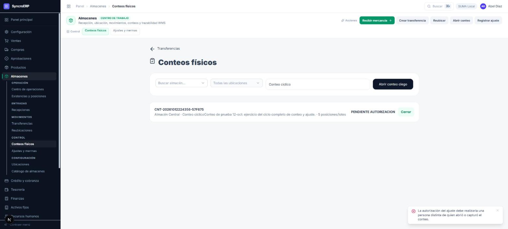

**Cómo se valúa lo que aparece de más:** al costo de su lote; si el lote no
tiene costo, al del último lote con costo de ese producto en ese almacén; y si
tampoco, al costo estándar o al precio de compra del catálogo. Si no hay
ninguno de los tres, el cierre se niega y lo dice —no inventa un costo cero,
que metería mercancía al almacén sin valor—. Lo que falta sale al costo
promedio del lote de donde se descuenta.

### Un conteo cuenta POSICIONES, no el total del almacén

La hoja de conteo se arma con lo que hay en `stock_ubicaciones`: cada producto,
en cada posición, con su lote. Es lo correcto —un almacenista cuenta un rack,
no un número abstracto— pero tiene una consecuencia que conviene entender:

**si un almacén tiene existencia que no está en ninguna posición, el conteo no
la ve, y contarla la duplica.** La hoja diría 98 donde el almacén cree tener
99; el almacenista contaría las 99 piezas que están ahí; la diferencia de +1
entraría como sobrante y el total del almacén pasaría a 100.

Por eso un conteo **no es** la herramienta para cuadrar un descuadre entre el
resumen del almacén y sus posiciones. Para eso está **Almacenes →
Reubicaciones**, que más abajo lista «Existencias sin posición» con un botón
**Ubicar** por renglón. Colocar una existencia sin posición no cambia ningún
total ni genera póliza: la mercancía ya está en el almacén y ya está valuada;
lo único que cambia es dónde dice el sistema que está.

## Entrada y salida rápidas desde el catálogo

En **Productos → Catálogo**, cada renglón tiene dos iconos: uno verde para
**entrar** mercancía y uno ámbar para **sacarla**. Sirven para lo que no llega
por una orden de compra ni se va por una venta: la caja que apareció sin
papeles, la pieza que se usó internamente, el faltante que alguien detectó.

**Lo que hacen, y lo que ya no te puede pasar:**

| | Qué mueve | Qué deja en los libros |
|---|---|---|
| Entrada (verde) | sube la existencia y el valor del almacén | una póliza que carga inventario y abona la cuenta de diferencias |
| Salida (ámbar) | baja la existencia y el valor | una póliza que carga costo de ventas y abona inventario |

Las dos quedan en el kardex **con tu nombre**. Y el motivo que escribes viaja al
concepto de la póliza, así que el contador lee en el libro lo mismo que tú
escribiste en la pantalla.

> **Hasta el 5 de octubre de 2026 estas dos puertas movían el valor del
> inventario sin generar ninguna póliza y sin guardar quién lo hizo.** El
> almacén cuadraba y la contabilidad no, y el kardex mostraba el movimiento con
> la columna de usuario vacía. Está corregido, pero si tu base tiene
> movimientos anteriores a esa fecha hechos por aquí, su contrapartida no
> existe: hay que buscarlos en el kardex y asentarlos a mano.

**Por qué la salida va a costo de ventas y no a mermas.** Una merma es una
pérdida que alguien declara como tal, y para eso está **Inventario → Ajustes**,
que sí la manda a la cuenta de mermas. La salida del catálogo no declara nada
—puede ser una muestra, un consumo o un faltante—, así que su valor va a costo
de ventas. De ese modo la cuenta de mermas sigue diciendo sólo lo que de verdad
se echó a perder, que es lo que el contador mira para decidir si hay un problema
en el almacén.

> **Qué te va a negar el sistema.** Una entrada cuyo producto no tiene costo de
> compra capturado: «el costo de entrada debe ser mayor a cero». Y cualquiera de
> las dos si la categoría del producto no tiene configuradas sus cuentas
> contables: el movimiento entra, y su póliza queda **fallida en la bandeja de
> asientos pendientes** nombrando qué cuenta falta. Nunca se contabiliza a
> medias.

---

# 6 · Abrir, cobrar y arquear la caja

**Quién:** `tesoreria` abre y cierra; `empleado` cobra. **Dónde:** Tesorería →
Caja, corte y arqueo, y el Punto de venta.

Este flujo está probado con **dos cajas abiertas a la vez** y una ráfaga de seis
cobros simultáneos, tres por caja: folios 4 a 9, sin repetidos y sin huecos.

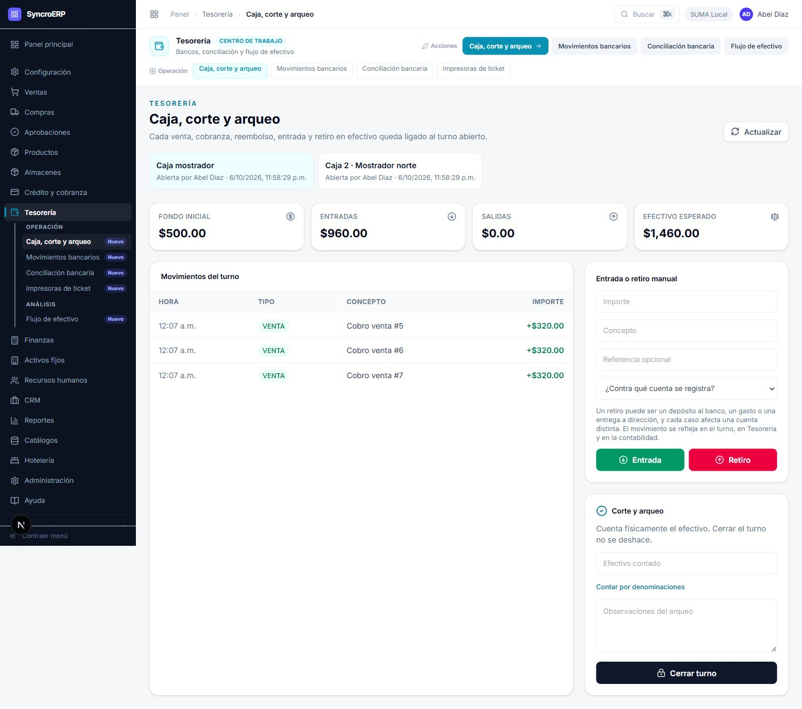

## Cómo está armado

Una **caja** es una cuenta bancaria de tipo CAJA, con su cuenta contable y, si
se quiere, su almacén y su lista de precios: el punto de venta las obedece.

Un **turno** se abre por caja, con su fondo inicial. La apertura corre con un
candado por caja, así que **dos personas no pueden abrir dos turnos sobre el
mismo cajón**, ni aunque pulsen al mismo instante.

## Los pasos

| # | Quién | Qué pasa |
|---|---|---|
| 1 | tesorería | Abre el turno de cada caja y declara su fondo inicial |
| 2 | empleado | Elige su caja en el punto de venta y cobra |
| 3 | tesorería | Registra entradas y retiros manuales, si los hay |
| 4 | tesorería | Cuenta el cajón y cierra |

## Varias cajas a la vez

El punto de venta propone la caja marcada «por omisión» de la empresa, que es
**la misma en todas las terminales**. Con tres mostradores, eso significa que
los tres cobrarían contra el mismo turno si nadie mira.

Dos cosas lo evitan, y conviene conocerlas:

- **La terminal recuerda su caja.** El cajón es del mostrador físico, no de la
  empresa. La de omisión sólo se propone en una terminal que no ha elegido
  nunca. Si una terminal se reinstala, vuelve a proponer la de la empresa.
- **El turno dice de quién es.** Bajo el desplegable sale «Turno abierto por
  Fulano · desde las 11:58», y **en ámbar cuando no eres tú**, con el remedio:
  «Si tu efectivo va a otro cajón, elige tu caja antes de cobrar».

**No se bloquea.** Hay mostradores donde se relevan en el mismo cajón y eso es
legítimo. Se dice, que es lo que permite darse cuenta antes de cobrar.

## Contar el cajón

El arqueo no pide un número: pide **el conteo por montones**, con las
denominaciones de México —billetes de $1,000 a $20, monedas de $20 a 50¢—, el
parcial de cada montón al lado y el total abajo.

Se hace así porque quien cuenta hacía la suma de cabeza o en el teléfono, y
cualquier error de esa suma se convierte en un faltante contabilizado a su
nombre; después nadie puede reconstruir si faltaba dinero o faltaba un cero.

Mientras el conteo por montones está abierto, **el total no se teclea: es el
resultado**. Dos cifras que pueden decir cosas distintas en la misma pantalla
son peor que una mal tecleada: la segunda se descubre, la primera se discute.

> El billete y la moneda de $20 se cuentan por separado. Valen lo mismo y
> conviven en el cajón; con una sola casilla, teclear unos borraría los otros.

## La diferencia se dice antes de cerrar

En cuanto hay una cifra contada, la pantalla resta: «**FALTAN $20.00**: cuentas
$130.00 y se esperaban $150.00», y dice qué va a pasar con la diferencia.

Esto importa porque **cerrar un turno no se deshace**, y si el conteo no cuadra
el sistema levanta una póliza de faltante o sobrante **a nombre de quien
cerró**. Enterarse después no sirve de nada.

Si hay diferencia, las observaciones son obligatorias. No es burocracia: es el
único sitio donde queda escrito por qué.

## Qué te va a negar el sistema

| Mensaje | Qué significa | Qué hacer |
|---|---|---|
| «Esta caja no tiene turno abierto: ábrelo en Tesorería → Caja, corte y arqueo antes de cobrar en efectivo.» | Correcto. Sin turno no hay dónde registrar el efectivo | Que tesorería abra el turno |
| Cerrar con el conteo por montones abierto y sin teclear una sola pieza | Se rechaza. Cerrar con cero contabilizaría **todo** el efectivo esperado como faltante | Si el cajón está vacío de verdad, se declara escribiendo un 0 |
| «Ya existe un turno abierto para esta caja» | Correcto, y es el candado | Usar el turno abierto, o cerrarlo antes |
| El desplegable de contrapartida sin cuentas de mayor | Correcto. «100 · Activo» no recibe pólizas | Elegir una cuenta de detalle |

## Lo que queda anotado

- **El cajero no puede abrir su propio turno** desde el punto de venta: el fondo
  inicial y el cierre son de tesorería. Es una decisión —abrir un turno es
  declarar un fondo—, pero con tres mostradores alguien tiene que abrir tres
  turnos cada mañana.
- El reparto de caja por terminal se guarda en el navegador de esa terminal.

---

# 7 · Vacaciones

**Quién la captura:** `rrhh`. **Quién la autoriza:** `gerencia`.

## Los pasos

| # | Qué pasa | Efecto en el saldo |
|---|---|---|
| 1 | RRHH captura la solicitud | días a **RESERVADOS** |
| 2 | Gerencia aprueba | RESERVADOS → **DISFRUTADOS** |
| 3 | Nace sola la incidencia de nómina | se paga en el periodo que la contiene |

## Las tres reglas de ley que el sistema aplica solo

1. **El derecho nace al año** (LFT art. 76). Antes de eso la pantalla lo dice con
   fecha: «Las vacaciones nacen al cumplir el primer año de servicios (LFT art.
   76). Este empleado lo cumple el AAAA-MM-DD.»
2. **Sólo se descuentan días laborables.** El domingo no cuenta (art. 69), y
   tampoco los días de descanso obligatorio del art. 74 —incluido el traslado de
   tres de ellos al lunes por el decreto de 2006—.
3. **La prima vacacional es el 25 %** y se paga sola (art. 80), exenta hasta 15
   UMA al año (LISR art. 93-XIV). No se captura en ninguna parte: sale de la
   incidencia.

## La pantalla cuenta lo mismo que el servidor, y lo dice antes

Al elegir el rango, la pantalla pregunta al servidor cuántos de esos días son
laborables y **enseña cuáles no cuentan y por qué** —domingo, día del art. 74,
excepción del calendario de la empresa—. Y compara ese número con el saldo:

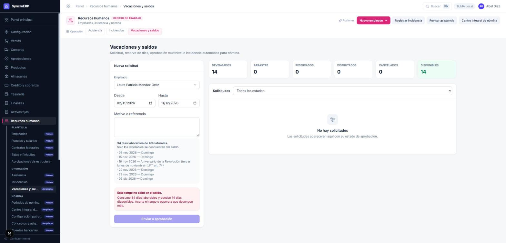

> «Este rango no cabe en el saldo. Consume 34 días laborables y quedan 14 días
> disponibles. Acorta el rango o espera a que devengue más.»

Hasta el 13-oct la pantalla contaba **naturales** —«40 días naturales
seleccionados»— y el número que de verdad importaba aparecía después de pulsar,
dentro de la negativa del servidor: «Saldo insuficiente. Disponibles: 14;
solicitados: 34». Un botón que llevaba a un no.

El cálculo lo hace el servidor, no la pantalla. Es a propósito: los días que no
cuentan salen del calendario laboral de la empresa y de la LFT, y una segunda
copia de esa regla en el navegador volvería a separarse de la buena.

## Qué te va a negar el sistema

> «Quien solicita vacaciones no puede aprobarlas.»

Si eres quien la capturó, no la firmas. Que la firme gerencia, o la otra persona
de Recursos humanos.

---

# 8 · Incidencias de nómina

**Quién las captura:** `rrhh`. **Quién las autoriza:** `gerencia` o `direccion`.

Una incidencia mueve dinero de alguien: una falta le quita días de sueldo, unas
horas extra se los suman. Por eso:

> «Quien registra una incidencia no puede aprobarla. Debe autorizarla Gerencia u
> otra persona de Recursos humanos.»

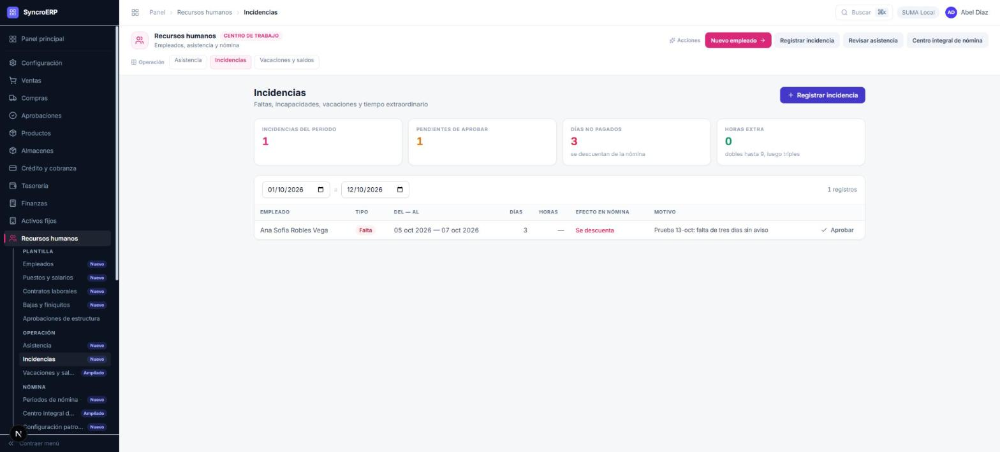

La fila dice el **efecto en nómina** sin que haya que abrirla —«Se descuenta»—,
y el formulario lo adelanta mientras se captura: «los 3 días se descuentan del
periodo». El botón «Aprobar» sigue a la vista porque para otra persona sí
funciona; lo que cambia es quién lo pulsa.

## Los estados, y qué significa cada uno en la pantalla

| Estado | Qué quiere decir |
|---|---|
| *(sin marca)* | Pendiente de aprobar. Cuenta en el indicador |
| **Aprobada** | Firmada, esperando el cálculo de nómina |
| **En nómina** | Ya movió un recibo |
| **Rechazada** | Resuelta en contra. No descuenta nada |
| **Cancelada** | Retirada después de aprobada. No descuenta nada |

Los indicadores de arriba cuentan **sólo lo que sigue vivo**: una incidencia
rechazada o cancelada no aparece en «Pendientes de aprobar» ni suma días en
«Días no pagados». Ese número y el de la nómina siempre dicen lo mismo.

## La que llega tarde

Si se aprueba una incidencia cuyo periodo **ya se pagó**, no se pierde: se
aplica **retroactivamente** en el siguiente periodo que se calcule, con su propio
renglón en el recibo y sus fechas:

> `Faltas de periodos anteriores (2026-09-30)`

No se esconde restando días del sueldo del mes, porque entonces el recibo diría
que se trabajaron menos días de los que se trabajaron.

---

# 9 · Correr la nómina

**Quién:** `rrhh`. **Quién firma el periodo:** `gerencia` y `direccion`.

## Los pasos

1. **Crear el periodo** — número, fechas y fecha de pago.
2. **Calcular** — trae a todos los empleados vigentes del periodo.
3. **Revisar las alertas**, si las hay.
4. **Aprobar, timbrar, dispersar y contabilizar.**

## El cálculo se niega si hay algo sin resolver

> «Hay N incidencias del periodo pendientes de resolución.»

Es a propósito: una nómina calculada con incidencias a medio firmar es una
nómina que habrá que recalcular.

## Las alertas dicen la dirección del error

No se limitan a avisar que algo no cuadra; dicen hacia dónde y qué implica:

> «SBC: el expediente informa $495.00 sin validar y la nómina cotiza con $472.19
> (mínimo de ley). **El informado es MAYOR que el calculado, así que si es el que
> está registrado ante el IMSS se estarían enterando cuotas de menos.** Valida el
> SBC en la ficha del empleado antes de timbrar y de enviar el SUA.»

---

# 10 · Pedido de venta: apartar, surtir y lo que queda en espera

**Quién:** `empleado` de ventas. **Dónde:** Ventas → Pedidos.

Una venta de mostrador **nace completada**: el cliente está delante y se lleva
la mercancía. Un pedido es lo otro: una promesa para después. Y una promesa que
no aparta nada es una promesa que el siguiente cliente se puede llevar.

## Los estados, y por qué no se escriben a mano

| Estado | Qué significa |
|---|---|
| **BORRADOR** | Capturado, sin apartar nada. Se edita libremente |
| **CONFIRMADO** | Comprometido con el cliente y con la mercancía apartada que hubiera |
| **SURTIDO_PARCIAL** | Se entregó parte. Lo que falta sigue comprometido |
| **SURTIDO** | No queda nada por entregar |
| **CANCELADO** | Se soltó lo apartado, con motivo escrito |

Los tres de en medio **se deducen de lo que falta por surtir**, no se guardan a
mano. Es a propósito: un estado que alguien pone con un botón y una cantidad que
cambia sola acaban diciendo cosas distintas, y el que miente es el estado.

## Los pasos

| # | Qué pasa | Dónde queda |
|---|---|---|
| 1 | Capturas cliente, almacén y renglones | **BORRADOR** |
| 2 | Confirmas | **CONFIRMADO**, y se intenta apartar cada renglón |
| 3 | Entregas, una o varias veces | **SURTIDO_PARCIAL** → **SURTIDO** |

Cada entrega **genera una venta de verdad**, con su folio, su póliza y su salida
de inventario. El pedido no es un documento contable: es el acuerdo. Lo que
mueve dinero es la venta que sale de él.

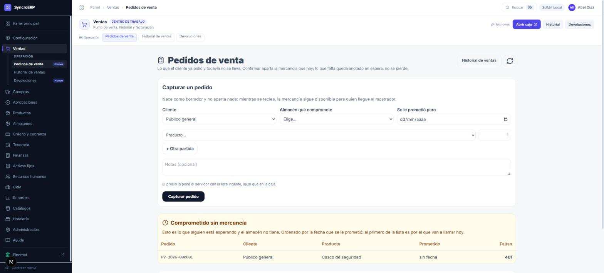

## Lo que el apartado hace, y lo que no

Confirmar **aparta** la existencia disponible en el almacén del pedido. Apartada
quiere decir que sigue en el piso pero ya no está disponible: el punto de venta
no la va a vender, la reposición la cuenta como comprometida.

Y **lo que no alcanzó no se inventa**. Si pides 500 y hay 99, se apartan 99 y
las 401 restantes quedan **en espera**: el pedido se confirma igual —el cliente
hizo su pedido— pero el sistema sabe que debe 401 piezas.

## El backorder se ve desde donde se compra

Esas 401 no se quedan en el pedido esperando a que alguien se acuerde. Aparecen
en **Productos → Reposición**, que por eso dice cuatro cosas y no una:

> Agotado · 99 en piso · 99 apartadas · esperan 401

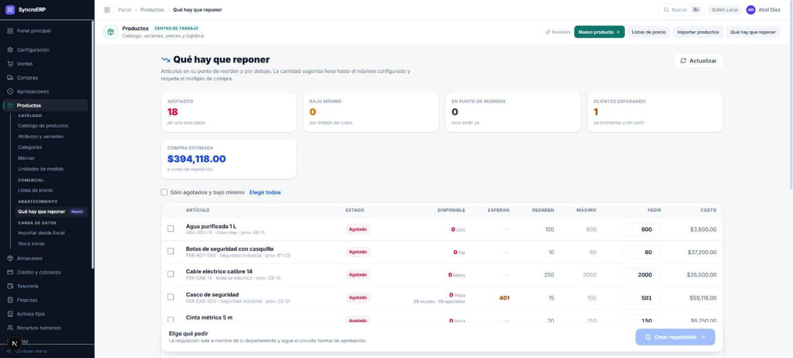

Lo que hay que comprar no es lo que falta para el mínimo: es lo que falta para
el mínimo **más lo que un cliente ya está esperando**. Un reporte de reposición
que no cuenta los pedidos pendientes manda a comprar de menos justo cuando más
hace falta.

Cuando entra la remesa, se vuelve a intentar el apartado desde el pedido y lo
que llegó queda comprometido con quien lo esperaba.

## Entregas parciales

Se surte indicando cuánto de cada renglón. Lo que se entrega sale de lo
apartado, no del piso libre: si el apartado se hizo, la mercancía es de ese
cliente aunque hayan pasado tres semanas.

## Qué te va a negar el sistema

| Lo que lees | Por qué |
|---|---|
| «La fecha de compromiso es anterior a la del pedido: se estaría prometiendo entregar antes de recibirlo.» | Un compromiso hacia atrás no es una fecha, es una errata |
| «Dile de qué almacén se compromete la mercancía: la reserva se hace ahí.» | Apartar sin almacén es apartar en ninguna parte |
| «El pedido todavía es un borrador: confírmalo antes de surtir.» | Un borrador no aparta nada, así que no hay de dónde entregar |
| «No hay nada apartado que surtir. Si entró mercancía, vuelve a intentar el apartado.» | Dice además qué hacer: el apartado se reintenta |
| «De «…» sólo hay N apartadas y se piden M. Quedan K en espera de mercancía: entra la remesa, vuelve a intentar el apartado y surte después.» | La negativa distingue «te equivocaste al capturar» de «todavía no ha llegado» |
| «Di por qué se cancela el pedido: es lo único que explicará dentro de seis meses por qué se soltó la mercancía.» | Cancelar suelta existencia que otro pudo haber comprado |
| «El pedido ya se surtió completo: lo que corresponde es una devolución de venta, no una cancelación.» | Lo entregado se devuelve; no se desaparece |

## Un límite que conviene conocer

**El apartado se decide con el resumen del almacén y la salida se sirve de las
ubicaciones.** Mientras los dos coincidan no se nota. Cuando no coinciden, el
pedido promete una pieza que la salida no encuentra, y el surtido se niega con
«Stock insuficiente no reservado» —con el cliente delante, no al confirmar—.

El 12 de octubre pasó con una pieza, y resultó no ser un misterio de almacén:
**la metía una devolución**. La devolución y la anulación de venta subían la
existencia sin ponerla en ninguna posición. Ya está corregido: lo que vuelve
cae en el andén de recepción, igual que una recepción. La historia completa, y
las dos piezas que quedaron sueltas antes del arreglo, están en
`06-limites-conocidos.md`.

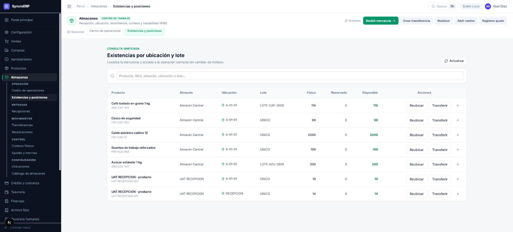

---

# 11 · Factura de proveedor y el cotejo de tres vías

**Quién:** `comprador` o cuentas por pagar. **Dónde:** Compras → Facturas de
proveedor.

Hasta aquí el ciclo de compra tenía dos lados: lo que se **pidió** (la orden) y
lo que **llegó** (la recepción). Falta el tercero, que es el que cobra: lo que
el proveedor **factura**. Pagar comparando sólo dos de los tres es cómo se paga
mercancía que no llegó, o se paga dos veces la que sí.

## Los estados

| Estado | Qué significa |
|---|---|
| **CAPTURADA** | Registrada, sin cotejar todavía |
| **CONCILIADA** | Cotejada contra la orden y la recepción: cuadra |
| **CON_DIFERENCIAS** | Cotejada y **no** cuadra. Dice cuáles renglones y con qué números |
| **CANCELADA** | Anulada con motivo. No se vuelve a cotejar |

## Los pasos

| # | Qué pasa | Estado |
|---|---|---|
| 1 | Capturas el comprobante y, si la tiene, su orden de compra | **CAPTURADA** |
| 2 | Cotejas | **CONCILIADA** o **CON_DIFERENCIAS** |
| 3 | El pago de la orden ya cuenta con ella | — |

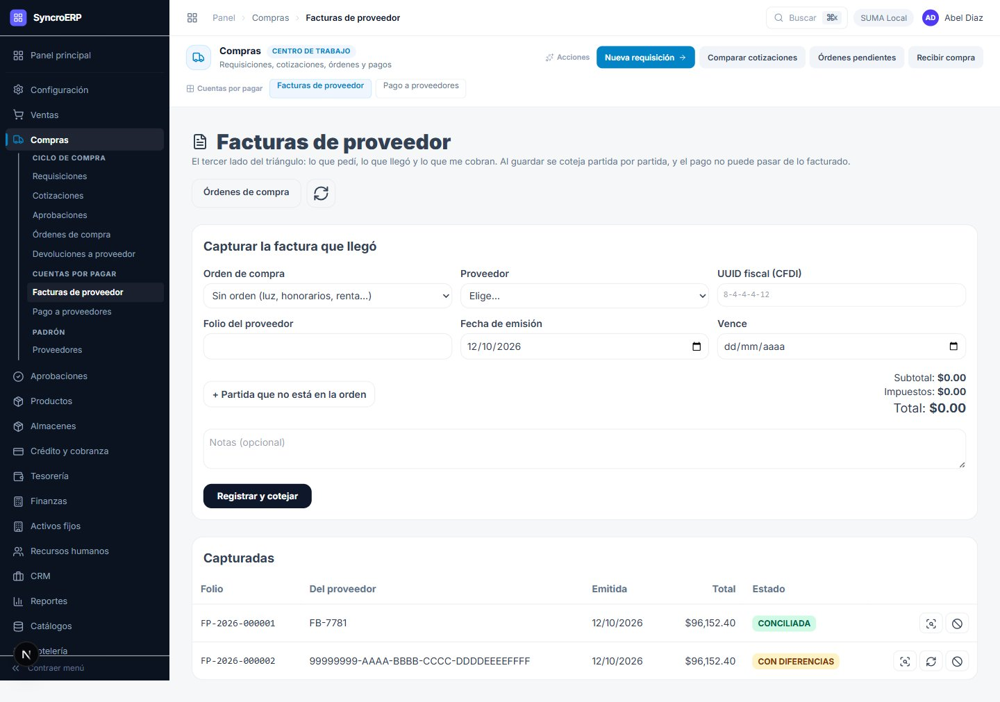

## El cotejo es renglón por renglón, no de totales

Dos facturas pueden sumar lo mismo y estar mal las dos: una con el doble de un
producto y la mitad de otro cuadra en el total. Así que se compara **cada
renglón** contra lo pedido y lo recibido, y el hallazgo dice **cuáles**, no
cuántos.

Las tolerancias, y por qué existen:

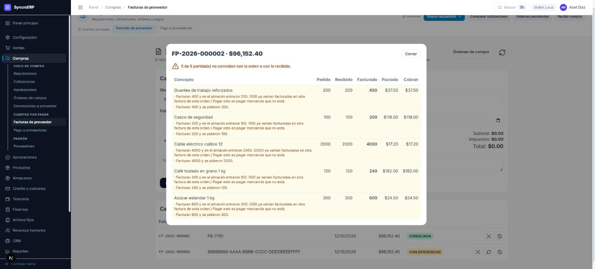

| Qué se compara | Tolerancia | Por qué |
|---|---|---|
| Cantidad | 0.0001 | Es el ruido de cuatro decimales, no una diferencia |
| Precio | **$1.00** o **0.5%**, el que resulte mayor | El redondeo de un proveedor en un renglón de $12,000 no es una incidencia; un peso en un renglón de $20 sí |

Lo que no es tolerancia es **mercancía que no llegó**: eso sale como diferencia
siempre, por pequeña que sea.

## El CFDI duplicado se niega con nombre y apellido

> «Ese CFDI ya está capturado como FP-2026-000001 (2026-10-11, $23,200.00).
> Capturarlo dos veces es cómo se paga dos veces.»

No dice «duplicado»: dice **cuál** es el que ya estaba, con su fecha y su
importe, para que quien captura pueda ver en dos segundos si es el mismo papel o
uno parecido.

## El techo que pone la factura

Antes, el máximo pagable de una orden era **lo recibido**. Ahora es el **menor**
entre lo recibido y lo facturado:

> De esta orden llegó 23200.00 pero el proveedor sólo ha facturado 11600.00 en 1
> comprobante(s). Ya se pagaron 0.00: el máximo ahora es 11600.00. Captura la
> factura que falta y el resto se podrá pagar.

La negativa **dice cuál de los dos números aprieta**. Sin eso, quien captura el
pago no sabe si le falta mercancía o le falta papel, y son dos llamadas
distintas a dos personas distintas.

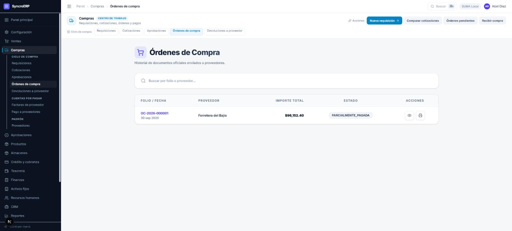

Si alguna factura de la orden tiene diferencias sin resolver, el mensaje también
lo nombra: pagar contra un comprobante que no cuadra es pagar la diferencia.

## Cancelar una factura capturada por error

Se cancela desde la lista, y **el motivo se teclea dentro del propio diálogo**:
el botón está apagado hasta que el texto alcanza el mínimo y dice cuántos
caracteres faltan.

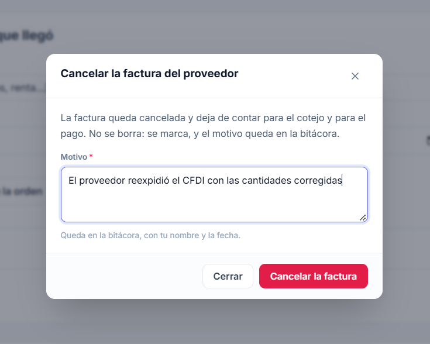

La factura **no se borra: se marca**, y el motivo queda en la bitácora con quién
y cuándo. Si el servidor se niega —porque la factura ya tiene pagos— la negativa
se pinta **dentro del diálogo, sin borrar lo escrito**, para corregir y
reintentar sin volver a teclearlo.

## Qué te va a negar el sistema

| Lo que lees | Por qué |
|---|---|
| «El UUID fiscal no tiene la forma de un folio fiscal del SAT (8-4-4-4-12). Si el comprobante no es un CFDI —un proveedor del extranjero, un recibo simple—, déjalo vacío.» | Un UUID mal escrito no detecta el duplicado, que es para lo único que sirve |
| «La factura dice estar emitida el … que todavía no llega.» | Una fecha futura casi siempre es un año mal teclado |
| «El total del comprobante dice $… y sus partidas suman $…. Revisa la captura: la diferencia no es un redondeo.» | El total es lo que se va a pagar; si no sale de los renglones, uno de los dos está mal |
| «Esta factura no tiene orden de compra, así que no hay contra qué cotejarla. Las facturas sin orden —luz, honorarios— se revisan a mano.» | No finge un cotejo que no puede hacer |
| «Esta factura tiene N pago(s) registrados y no se cancela: el pago quedaría sin documento que lo respalde. Si el proveedor la canceló ante el SAT, registra su nota de crédito.» | Y dice cuál es el camino correcto |

## Lo que todavía no hace

- **El pago no se ata a una factura concreta.** Sube el techo del pago de la
  orden, pero no queda registrado *qué comprobante* se pagó con *qué
  transferencia*. El campo existe en la base; falta usarlo.
- **La nota de crédito de proveedor** no está. Cuando el proveedor factura de
  más y lo corrige, hoy se arregla cancelando y recapturando.
- En la pantalla de pago, el «Máximo a pagar ahora» que ves **se calcula sin
  saber del techo de la factura**: puede ofrecerte más de lo que el servidor va
  a aceptar. El servidor es el que manda, y te lo dirá con el mensaje de arriba.

---

# 12 · Centros de costo y presupuestos

**Quién:** `contador`, `finanzas`. **Dónde:** Finanzas → Centros de costo y
Finanzas → Presupuestos.

Un catálogo contable dice **en qué** se gastó. Un centro de costo dice **dónde**:
la sucursal, el departamento, la obra. Con los dos, el estado de resultados se
puede abrir por lugar, que es la pregunta que se hace de verdad en una junta.

## El árbol, y las dos reglas que lo sostienen

Los centros cuelgan unos de otros. De eso salen dos negativas que al principio
sorprenden y luego se agradecen:

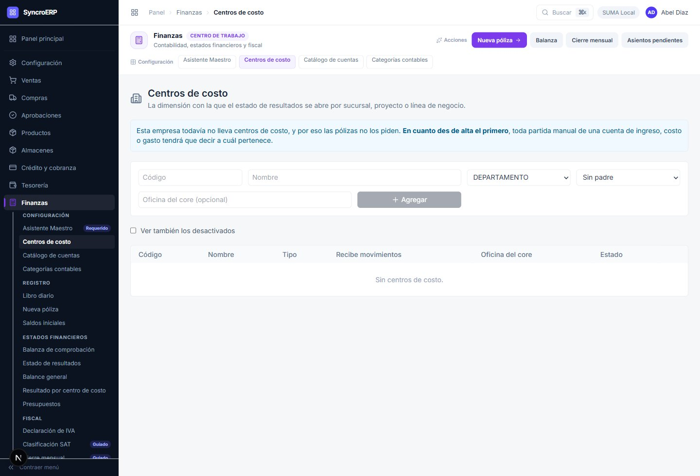

| Lo que lees | Por qué |
|---|---|
| ««…» agrupa a N centro(s): su saldo es la suma de ellos. Si recibiera movimientos propios, el reporte por centro dejaría de cuadrar con el total.» | Un agrupador con movimientos propios hace que el total no sea la suma de las partes |
| ««…» tiene N partida(s) de póliza registradas y no se puede borrar: los reportes por centro dejarían de cuadrar. Desactívalo en su lugar — deja de ofrecerse para capturar y su historia se conserva.» | Borrar un centro con historia reescribe el pasado |
| ««…» ya cuelga de este centro: ponerlo como padre cerraría un círculo.» | Un árbol con un ciclo no tiene totales |
| «No se puede desactivar: N centro(s) activo(s) cuelgan de éste y quedarían colgando de un padre inactivo. Desactiva primero los hijos.» | Dice el orden, no sólo el impedimento |

## El presupuesto

Un presupuesto es, por ejercicio: **cuenta + centro + mes + importe**. Se captura
en borrador, se aprueba, y desde ese momento **ya no se edita**.

> «Este presupuesto está APROBADO y ya no se edita: contra él se está midiendo.
> Si las cifras cambiaron, crea una revisión —«Revisión de junio»— y compara
> contra ésa. **Un presupuesto que se ajusta al real no tiene desviaciones
> nunca.**»

Esa última frase es el motivo entero. Un presupuesto editable es un presupuesto
que al final del año coincide con el gasto, y entonces no sirvió para nada.

### Qué se puede presupuestar y qué no

| Lo que lees | Por qué |
|---|---|
| «La cuenta … es de BALANCE y no se presupuesta aquí: este presupuesto es de resultado —ingresos, costos y gastos—. El saldo de una cuenta de balance no se ejerce, así que compararlo contra un presupuesto no diría nada.» | Un banco no se «ejerce» |
| «… es una cuenta de mayor: su saldo es la suma de sus hijas. Presupuéstalas a ellas, o el comparativo contaría el mismo importe dos veces.» | La misma regla del árbol, en el catálogo |
| «El importe presupuestado se captura en positivo, en el sentido natural de la cuenta: lo que se espera ingresar en una de ingreso, lo que se espera gastar en una de gasto.» | Evita el signo al revés, que invierte la desviación |
| «No se puede aprobar un presupuesto sin líneas: el comparativo diría que todo el gasto del ejercicio es desviación.» | Un presupuesto vacío no es un presupuesto en cero |

## El comparativo

**Finanzas → Resultado por centro** cruza lo presupuestado con lo ejercido, por
centro y por mes. Lo ejercido sale de las partidas de póliza, que es la misma
fuente que la balanza: el comparativo y la contabilidad no pueden diferir porque
leen lo mismo.

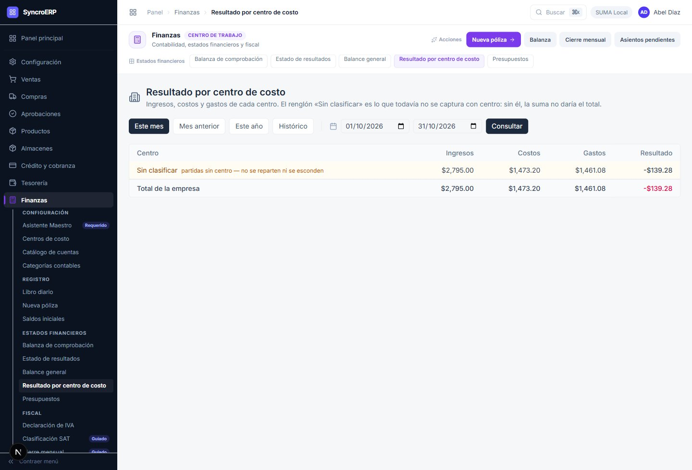

Y hay un renglón que conviene mirar antes que ninguno: **«Sin clasificar»**. Son
las partidas que todavía no llevan centro. No se reparten entre los demás ni se
esconden, porque las dos cosas harían que el reporte cuadrara mintiendo. Si ese
renglón es grande, el reporte por centro todavía no sirve para decidir.

---

# 13 · Cerrar el ejercicio

**Quién:** `contador`. **Dónde:** Finanzas → Cierre del ejercicio.

Cerrar el año es un asiento: los saldos de **ingresos, costos y gastos** se
saldan contra la cuenta de **Resultado del ejercicio**. Al terminar, esas
cuentas arrancan el año siguiente en cero y el capital refleja lo que se ganó o
se perdió.

## Primero el diagnóstico, y nombra cada impedimento

La pantalla **no** ofrece un botón de cerrar hasta que puede. Antes dice, en
palabras, qué falta:

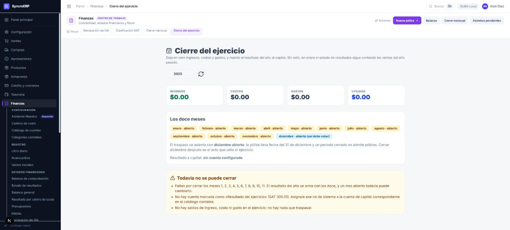

| Lo que lees | Qué hacer |
|---|---|
| «Faltan por cerrar los meses 1, 2, 3… El resultado del año se arma con los doce, y un mes abierto todavía puede cambiarlo.» | Cerrar los meses pendientes |
| «No hay cuenta marcada como «Resultado del ejercicio» (SAT 305.01). Asígnale ese rol de sistema a la cuenta de capital correspondiente en el catálogo contable.» | Marcar la cuenta en Finanzas → Cuentas contables |
| «No hay saldos de ingreso, costo ni gasto en el ejercicio: no hay nada que traspasar.» | Nada: no hay ejercicio que cerrar |
| «Diciembre ya está cerrado y la póliza de traspaso lleva fecha de diciembre. Reábrelo con su motivo, asienta el traspaso y vuelve a cerrarlo: ése es el acto que sella el ejercicio.» | Reabrir diciembre, traspasar, cerrar |
| «El resultado de este ejercicio ya se traspasó. Volver a hacerlo lo contaría dos veces.» | Nada. Ya está |

**Diciembre tiene que estar abierto** cuando se traspasa, porque la póliza lleva
fecha de diciembre y el candado de período la rechazaría. El orden es: once
meses cerrados, diciembre abierto, traspaso, y entonces cerrar diciembre. Ese
último cierre es el que sella el año.

## Lo que hace el traspaso

- **El signo lo decide el saldo, no el tipo de cuenta.** Una cuenta de ingreso
  con saldo deudor —pasa, con devoluciones y cancelaciones— se salda del otro
  lado. Decidir por el tipo produce un asiento que cuadra y miente.
- **Se salda por cuenta y por centro de costo.** Si una cuenta tuvo movimientos
  en tres centros, salen tres partidas. Saldarla en bloque dejaría el reporte
  por centro con saldos de un ejercicio que ya cerró.
- **La partida del resultado va sin centro.** El resultado del ejercicio es de
  la empresa, no de una sucursal.
- **Va por la misma puerta que cualquier póliza manual**: su folio, su candado
  de período, su validación de cuentas afectables y su cuadre. El cierre del año
  no merece una puerta propia — y una puerta propia es como se pierden esas
  cuatro cosas de golpe.
- **Se puede pulsar dos veces sin miedo.** El asiento lleva una clave de origen
  por empresa y ejercicio; el segundo intento no crea nada y lo dice.

## Antes de diciembre

Hay una cosa que no se puede dejar para el 31: **marcar la cuenta de capital con
el rol «Resultado del ejercicio»**. Se hace en Finanzas → Cuentas contables, en
la ficha de la cuenta. Sin eso el cierre no procede, y el 31 de diciembre no es
el día de descubrirlo.

---

# 14 · Cuando el sistema te dice que no

Tres respuestas distintas que conviene no confundir:

| Lo que lees | Qué significa | Qué hacer |
|---|---|---|
| «Tu perfil no incluye esta acción. Pide acceso al administrador.» | **Permiso.** Tu rol no tiene esa pantalla o ese botón | Pedir el acceso, si de verdad te toca |
| Un mensaje que explica una regla —«Quien solicita… no puede…», «La venta tiene N días…» | **Regla de negocio.** Tu permiso está bien | Que firme quien le toca, o corregir el documento |
| «No hay conexión con el servidor.» | El backend no responde | Avisar a sistemas |

Y una regla de redacción que atraviesa las tres: **cuando un mensaje trae un
importe, va en pesos y con su formato**, igual que en el resto de la pantalla.
Un número crudo se lee mal a la primera —«-6150.00» puede ser seis mil o
seiscientos quince hasta que uno cuenta los dígitos— y una tolerancia sin unidad
parece un conteo:

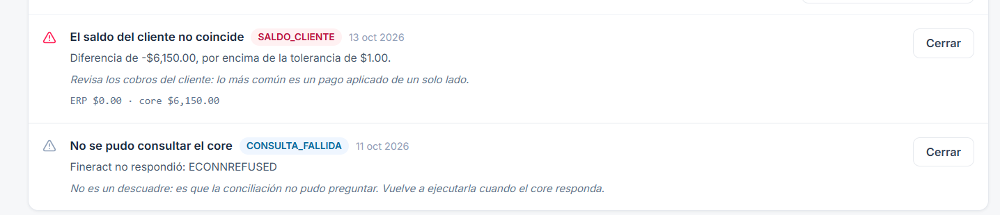

La diferencia entre las dos primeras es la que más tiempo ahorra. **Si el
mensaje te explica una regla, pedir más permisos no sirve de nada**: el sistema
no te está negando el acceso, te está diciendo que esa operación necesita a otra
persona.

---

# 15 · Depreciación de activos fijos (y cómo deshacerla)

Un activo se da de alta en **Activos fijos → Registro de activos** con su costo,
su categoría y la fecha en que empieza a depreciarse. La categoría trae la tasa
anual y las dos cuentas —gasto y depreciación acumulada—, así que el alta no
pide números contables.

## La corrida

**Activos fijos → Corrida de depreciación.** Se elige mes y ejercicio y se
ejecuta. La pantalla no deprecia nada hasta que se confirma, y enseña el detalle
activo por activo antes de que nada llegue a la contabilidad.

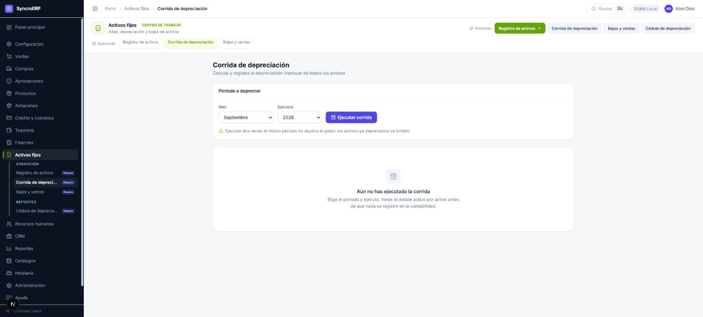

**Se deprecia por meses completos y vencidos.** Un periodo que aún no termina se
niega:

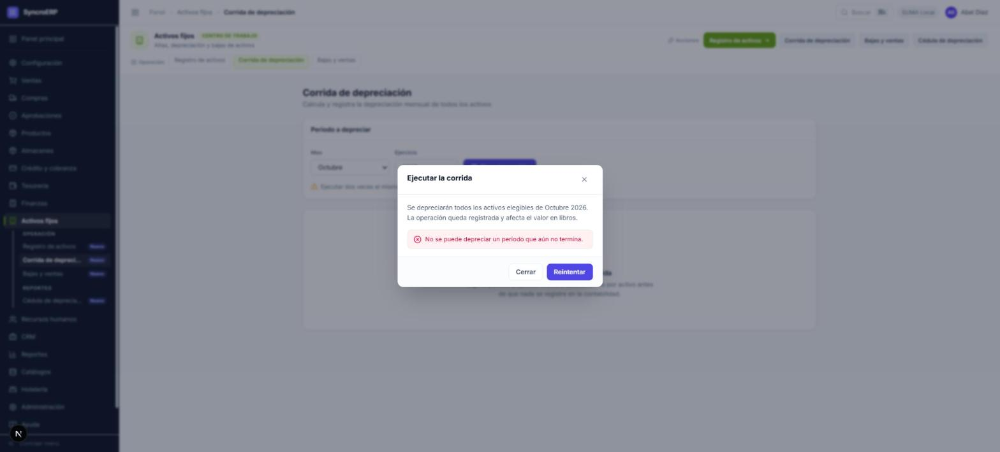

Y **no se puede saltar un mes**: si un activo tiene periodos anteriores
pendientes, la corrida se niega y **nombra el activo** que la detiene —«existen
activos con periodos anteriores pendientes (AF-000002)»—, para que no haya que
adivinar cuál es.

Ejecutar dos veces el mismo periodo **no duplica el gasto**: los activos ya
depreciados se omiten, y la columna de observación dice por qué quedó fuera cada
uno —«Su depreciación inicia después de este periodo», «Ya depreciado en este
periodo»—.

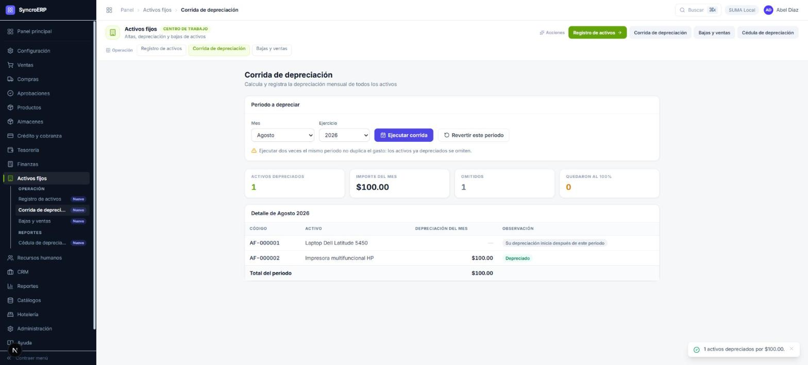

## La póliza

La corrida escribe su propia póliza de diario: cargo a la cuenta de gasto de la
categoría, abono a la de depreciación acumulada. Si la contabilidad estuviera mal
configurada, la operación **no se cae**: queda en **Finanzas → Asientos
pendientes** para resolverla sin perder la corrida.

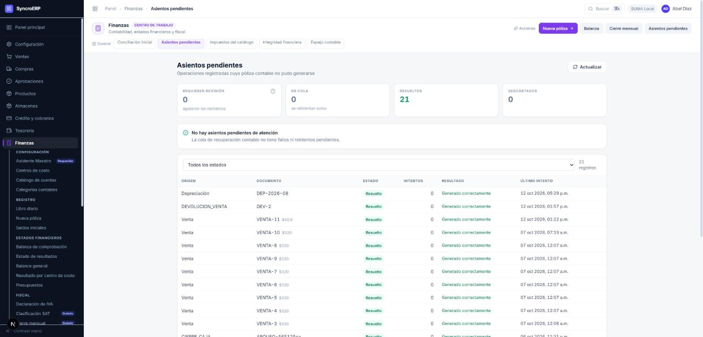

## La cédula

**Activos fijos → Cédula de depreciación** es el reporte del ejercicio, activo
por activo, con el valor en libros al cierre. Se exporta e imprime.

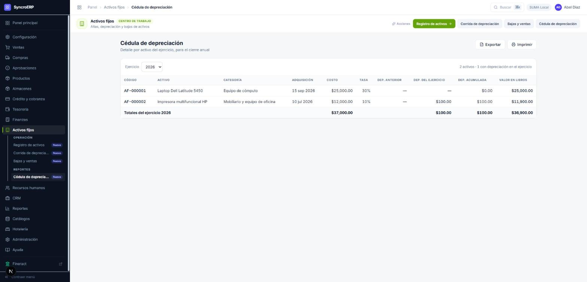

## Deshacer una corrida

Se revierte **sólo el último periodo depreciado** —revertir en medio dejaría un
hueco en la cadena— y **sólo si ese mes ya no está contabilizado**. Si la póliza
sigue vigente, el sistema se niega y dice exactamente qué hacer:

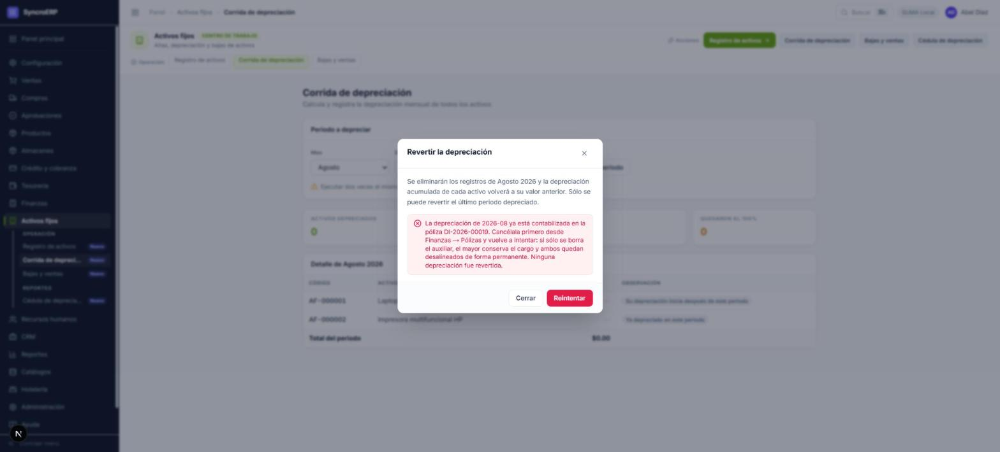

> «La depreciación de 2026-08 ya está contabilizada en la póliza DI-2026-00019.
> Cancélala primero desde Finanzas → Pólizas, SIN marcar «Volver a generar la
> póliza del documento» […], y vuelve a intentar. […] Ninguna depreciación fue
> revertida.»

**Por qué importa esa casilla.** En **Finanzas → Libro diario** se abre la
póliza y se cancela con un motivo. Cancelar **no borra**: genera una póliza de
reversa con los importes invertidos y conserva la original en el libro. La
casilla «Volver a generar la póliza del documento» viene encendida por omisión
—es lo correcto para una recepción o una venta, que no pueden quedarse sin
contabilidad—, pero **para una depreciación hay que dejarla apagada**: si se
vuelve a generar, el asiento se rehace en segundos y la reversión se niega otra
vez. La pantalla la apaga sola cuando la póliza nació de una depreciación, y
dice por qué.

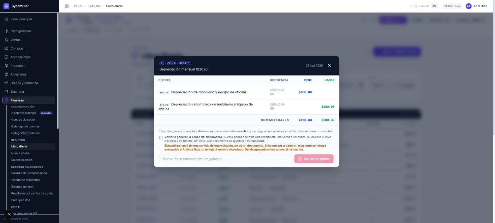

Con la póliza cancelada, la reversión procede: la depreciación acumulada de cada
activo vuelve a su valor anterior, el contador de meses baja y el activo que
hubiera quedado al 100% vuelve a estar activo.

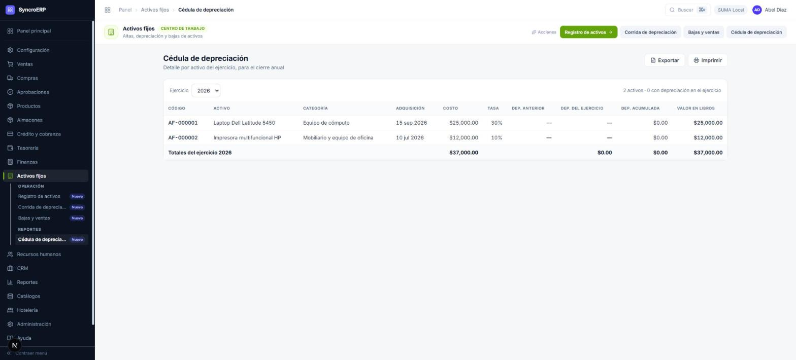

**El orden, en una línea:** cancelar la póliza (sin regenerar) → revertir la
corrida → corregir lo que haya que corregir → volver a correr el periodo.

---

# 16 · Cotizar y adjudicar

**Quién:** `compras`. **De dónde viene:** una requisición ya firmada.

Las requisiciones autorizadas bajan solas a **Compras → Cotizaciones**. Mientras
esperan firma, la pantalla lo dice en vez de enseñar una lista vacía:

> «Nada por cotizar todavía. 2 requisiciones esperan autorización. Bajan aquí en
> cuanto se firmen.»

Cada proveedor manda su propuesta, y la pantalla las pone **una debajo de otra
con las mismas partidas**: cantidad, precio unitario, importe, subtotal, IVA y
total ofertado, más las condiciones tal y como las escribió el proveedor
—«Entrega en 3 días hábiles. Pago a 30 días. Precios firmes 15 días.»— y el PDF
original de cada una.

Al adjudicar, el ganador queda marcado y **la orden de compra nace sola**; la
otra propuesta se queda en el expediente como **DESCARTADA**, no se borra.

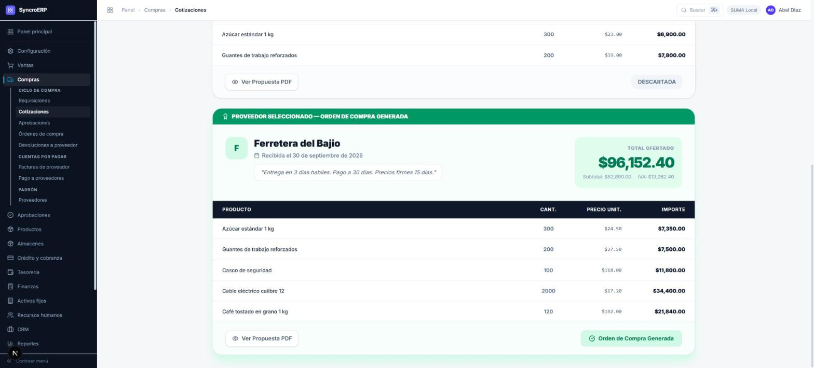

**Un límite que conviene saber antes de usarlo:** se adjudica a **un proveedor la
requisición entera**, no partida por partida. En el ejemplo ganó quien daba el
total más bajo y, aun así, el otro era más barato en tres de los cinco renglones.
Repartir una requisición entre dos proveedores hoy se hace a mano, partiéndola en
dos. Está anotado en `06-limites-conocidos.md`.

---

# 17 · El embudo de ventas, de prospecto a cliente

**Quién:** `ventas`. **Dónde:** CRM → Pipeline.

## Las cinco etapas, y por qué llevan un porcentaje

| Etapa | Probabilidad |
|---|---|
| Prospecto | 10 % |
| Contactado | 25 % |
| Calificado | 45 % |
| Propuesta | 65 % |
| Negociación | 85 % |

El tablero suma dos cosas distintas y las enseña separadas: el **valor total**
—lo que suman las oportunidades abiertas— y el **pronóstico ponderado**, que
multiplica cada una por la probabilidad de su etapa. Una oportunidad de $185,000
vale $18,500 de pronóstico en Prospecto y $157,250 en Negociación. Mover una
tarjeta recalcula los dos al instante.

También cuenta las **estancadas**: las que llevan tiempo sin moverse. Un embudo
sin esa columna se llena de oportunidades que nadie ha tocado en meses y sigue
pronosticando sobre ellas.

## Dar de alta un prospecto sin salir de la oportunidad

El alta del prospecto está **dentro** del formulario de la oportunidad: no hay
que ir a otra pantalla y volver. Y pide lo mínimo con una regla escrita:

> «Escribe un correo o un teléfono: sin uno de los dos no hay forma de
> contactarlo.»

## Ganar no es terminar

Al mover una oportunidad a **Ganada**, el sistema no se calla ni da por hecho
que ya hay cliente:

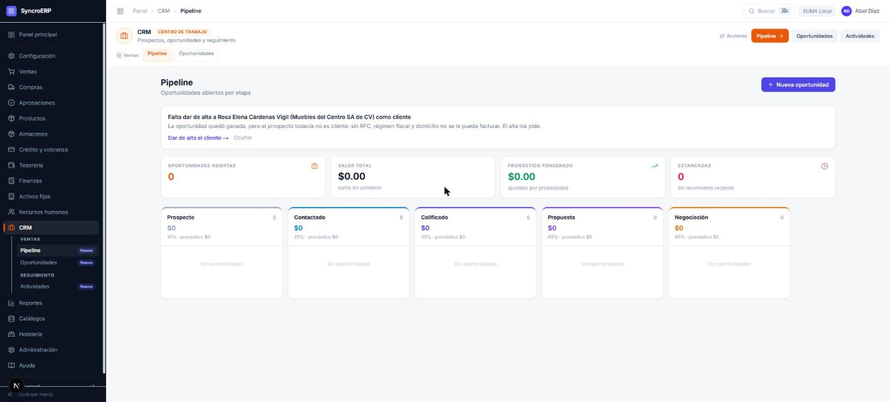

> «La oportunidad quedó ganada, pero el prospecto todavía no es cliente: sin
> RFC, régimen fiscal y domicilio no se le puede facturar. El alta los pide.»

El enlace abre el alta de clientes **con lo que ya se sabe**, y reparte cada dato
donde va. Si el prospecto trae empresa, el cliente es la empresa y la persona
pasa a ser el contacto:

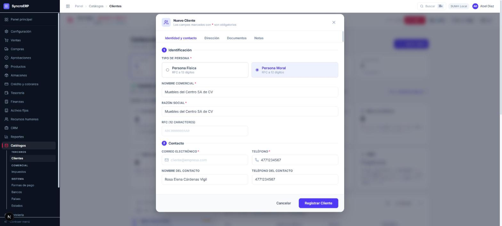

## Las actividades cuelgan de una oportunidad abierta

Llamadas, reuniones y visitas se agendan **contra una oportunidad**, no sueltas:
es lo que permite saber después qué se hizo para ganar o perder un negocio. Por
eso, si no hay ninguna oportunidad abierta, la pantalla lo dice y lleva al
Pipeline en vez de abrir un formulario que no se podría contestar:

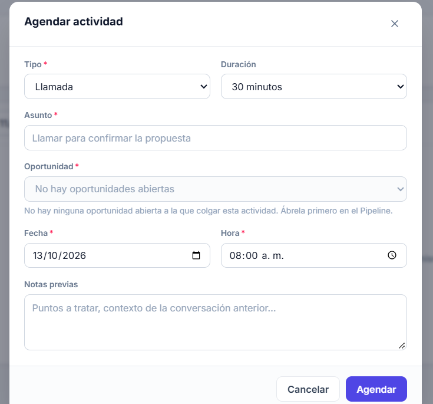

Los datos viajan **por la API y no por la barra de direcciones**: en el enlace
sólo va el identificador del prospecto. Un nombre y un teléfono en la URL
acabarían en el historial del navegador y en los registros del servidor.

---

# 18 · Dónde se lee esto

Todo este documento, y los demás, están **dentro del propio ERP**: menú
**Ayuda → Ayuda y documentación**. Se leen en pantalla, con su índice lateral, y
se descargan en PDF.

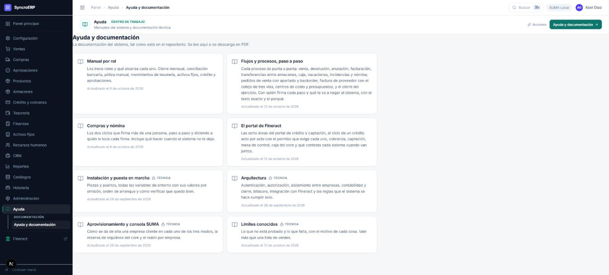

El backend los lee del repositorio en cada petición, así que **corregir un
documento lo corrige también en la pantalla**, sin volver a desplegar nada. Los
cuatro documentos técnicos —instalación, arquitectura, aprovisionamiento y
límites— los ve sólo el administrador, y por eso ni siquiera aparecen en el
índice de quien no puede abrirlos: nadie choca contra una puerta cerrada.
