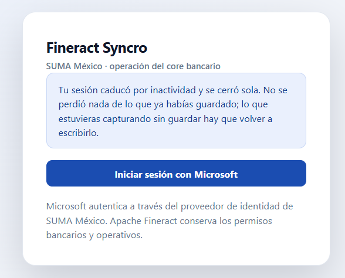
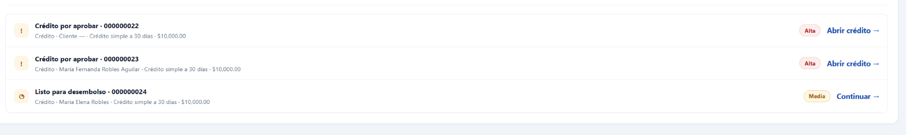
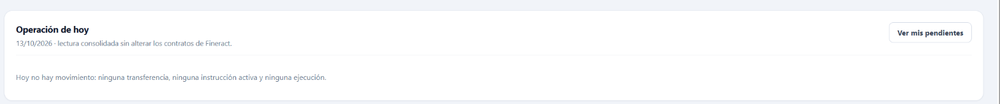
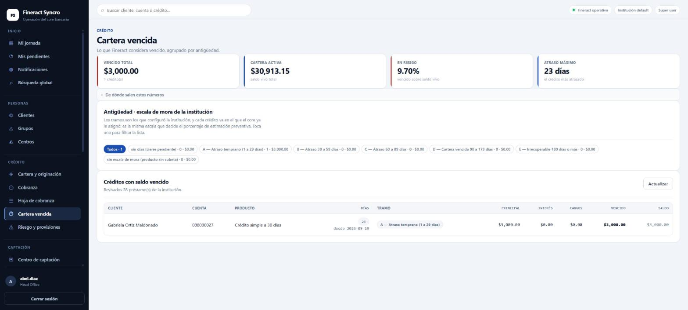
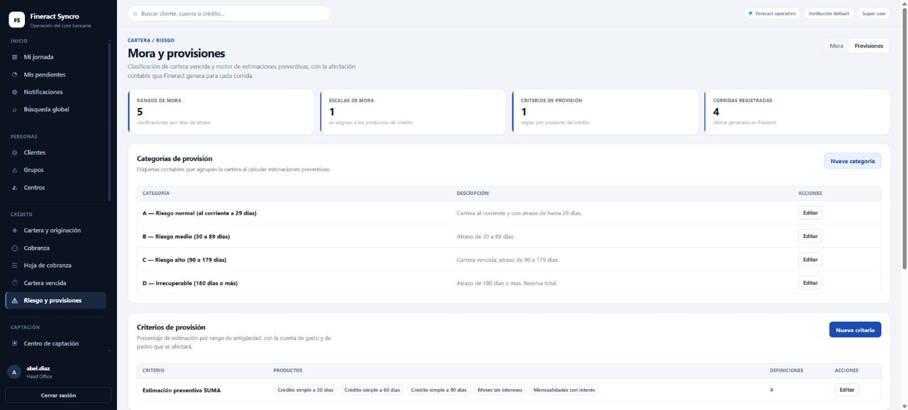

# 08 · El portal de Fineract, paso a paso

**Revisión:** 13 de octubre de 2026
**Para:** quien opera crédito y captación, y quien los capacita.
**Dónde:** el portal, aparte del ERP. En la instalación local, en el puerto 3002.

> Lo que está aquí se leyó del código que se despliega: las ocho áreas del menú,
> los comandos que el portal deja ejecutar sobre un crédito y el permiso que
> cada uno exige. Lo que **todavía no** está aquí, y se dice sin rodeos, son los
> recorridos con capturas pantalla por pantalla: eso va en la siguiente
> revisión, igual que se hizo con los flujos del ERP.

**El estado real de cada dominio** —qué está completo, qué parcial y qué falta,
dominio por dominio— lo mantiene el equipo en
`fineract/docs/FINERACT_UI_COVERAGE.md`, medido contra la instancia corriendo.
Este documento no lo repite: una segunda copia de ese estado envejecería, y
entonces habría dos verdades.

---

## Qué es el portal, y qué no es

Apache Fineract es el **core bancario**: lleva clientes, créditos, ahorro,
depósitos, acciones y su contabilidad. El portal es la pantalla con la que SUMA
lo opera, en español y con los controles que una institución mexicana necesita.

Dos cosas que conviene tener claras desde el primer día:

- **El portal no guarda nada propio.** Todo vive en Fineract. El portal valida,
  traduce y normaliza los errores del core, pero el dato es del core.
- **El portal no es un proxy abierto al core.** Cada operación pasa por un
  endpoint propio que comprueba la sesión, valida lo que entra y exige el
  permiso de Fineract que corresponde. Una consola que mandara llamadas
  arbitrarias al core sería más corta de escribir y una superficie de riesgo
  mucho mayor; está decidido que no se hace.

### La sesión caduca por inactividad, y lo dice

La sesión inactiva del directorio está en **30 minutos**, y el portal sólo
renueva su token cuando llega una petición. Un portal abierto sin usarse pasado
ese plazo vuelve al acceso **por sí solo**; eso no es una avería, pero una
pantalla de acceso que aparece sola se lee como si algo se hubiera roto, así que
lo dice:

Lo guardado está guardado; lo que se estuviera capturando sin guardar hay que
volver a escribirlo. **Los 30 minutos son una decisión de operación**: para un
mostrador son cortos, y se cambian en el directorio, no en el portal.

### Y el ERP, ¿dónde queda?

El producto se vende de tres formas —sólo ERP, sólo Fineract, ERP + Fineract—.
Cuando van juntos, el reparto es:

| Lo que se pregunta | Quién lo contesta |
|---|---|
| Qué le vendí a este cliente | El ERP |
| Cuánto me debe y en qué plan de pagos | Fineract |
| Qué cobré hoy en el mostrador | El ERP |
| Qué cobré hoy de cartera | Fineract |
| La póliza de todo eso | El ERP, con el espejo contable del core |

El detalle de la integración está en `02-arquitectura.md`, y cómo se da de alta
una institución en `05-aprovisionamiento-y-consola-suma.md`.

---

## Las ocho áreas del menú

| Área | Qué se hace ahí |
|---|---|
| **Inicio** | Mi jornada, mis pendientes, notificaciones y la búsqueda global |
| **Personas** | Clientes, grupos y centros. El expediente: identificadores, domicilios, familiares, garantías, notas y documentos |
| **Crédito** | Cartera y originación, cobranza, hoja de cobranza, cartera vencida, riesgo y provisiones |
| **Captación** | Centro de captación, cuentas de ahorro, depósitos a plazo, depósitos recurrentes y acciones |
| **Operación** | Centro de operaciones (transferencias e instrucciones permanentes) y caja y tesorería |
| **Control** | Mesa de control, reportes y contabilidad |
| **Productos** | Las definiciones: crédito, ahorro, plazo fijo, recurrente y acciones |
| **Administración** | Configuración institucional: oficinas, personal, usuarios, roles, catálogos, día operativo, trabajos, integraciones |

### Mi jornada, que es por donde se empieza

La bandeja ordena lo que requiere intervención por prioridad, y cada renglón
lleva su acción a la derecha:

### Un cero también se dice

Las franjas de indicadores **esconden las métricas en cero** —en una institución
en marcha la mayoría lo están, y llenaban la parte de arriba de tarjetas que
sólo confirmaban que no había nada que hacer—. Cuando esa franja **es** toda la
sección, esconderla dejaría un hueco que se lee como una pantalla a medio
cargar, así que en su lugar se dice con palabras:

El menú **no enseña lo que no se puede abrir**: cada entrada depende de los
permisos de la sesión en Fineract. Si alguien no ve un área, lo que le falta es
un permiso en su rol, no una actualización del portal.

---

# 1 · El ciclo de un crédito, de la solicitud al finiquito

Es el flujo que más se usa y el único que este documento cuenta completo, porque
es el que se pudo verificar comando por comando.

## Los actos, y el permiso que exige cada uno

| Acto | Qué hace | Permiso en Fineract |
|---|---|---|
| **Aprobar** | Autoriza la solicitud | `APPROVE_LOAN` |
| **Deshacer la aprobación** | La devuelve a solicitud | `APPROVALUNDO_LOAN` |
| **Rechazar** | La cierra negada, con fecha | `REJECT_LOAN` |
| **Retirar** | La cierra porque el solicitante se retiró | `WITHDRAW_LOAN` |
| **Desembolsar** | Entrega el dinero | `DISBURSE_LOAN` |
| **Deshacer el desembolso** | Revierte la entrega | `DISBURSALUNDO_LOAN` |
| **Asignar responsable** | Pone al promotor del crédito | `UPDATELOANOFFICER_LOAN` |
| **Quitar responsable** | Lo libera | `REMOVELOANOFFICER_LOAN` |
| **Recuperar garantías** | Ejecuta el colateral | `RECOVERGUARANTEES_LOAN` |

Y sobre un crédito ya vivo:

| Movimiento | Qué hace | Permiso |
|---|---|---|
| **Pago** | Abona al crédito, con su forma de pago | `REPAYMENT_LOAN` |
| **Condonar interés** | Perdona una porción de interés | `WAIVEINTERESTPORTION_LOAN` |
| **Castigar (quebranto)** | Lo da por perdido, **con causa** | `WRITEOFF_LOAN` |
| **Deshacer el castigo** | Lo revive | `UNDOWRITEOFF_LOAN` |
| **Pago de recuperación** | Cobra sobre un crédito ya castigado | `RECOVERYPAYMENT_LOAN` |
| **Devolución en efectivo** | Regresa dinero al cliente | `REFUNDBYCASH_LOAN` |
| **Finiquito anticipado** | Lo liquida antes del plazo | `FORECLOSURE_LOAN` |
| **Devolución de saldo a favor** | Regresa un sobrepago | `CREDITBALANCEREFUND_LOAN` |

**Un «no autorizado» en cualquiera de estos actos es un permiso del rol en
Fineract**, no un problema del portal. Se reparte en Administración → Usuarios y
roles.

## El castigo lleva motivo, y no es burocracia

Castigar admite y **pide** la causa del quebranto. Sin ella el crédito queda
castigado sin razón registrada, y el reporte de cartera castigada por motivo
—el que se presenta— sale vacío. Un número sin desglose no se puede defender
ante nadie.

## Aprobar puede recalendarizar en el mismo acto

Al aprobar se pueden redefinir los **tramos de desembolso**: aprobar un monto
menor al solicitado y repartirlo distinto, en una sola operación. Lo que no deja
es que no cuadre:

> «La suma de los tramos (45000.00) debe igualar el monto aprobado (50000.00).»

Antes había que aprobar primero y corregir los tramos con otra operación, con el
crédito aprobado por un reparto que nadie quería.

## El desembolso directo a la cuenta de ahorro está cerrado, a propósito

Si se intenta, el portal contesta:

> «El desembolso a cuenta de ahorro está deshabilitado en esta institución:
> Fineract no ofrece segunda firma para esa operación, así que sería un camino
> para desembolsar sin la autorización que sí exige el desembolso normal.
> Desembolsa por el camino habitual y, si el dinero debe quedar en la cuenta de
> ahorro del socio, hazlo después como transferencia entre cuentas.»

**No se pierde una capacidad, se pierde un atajo**: el desembolso sigue
existiendo por el camino con doble firma, y la transferencia a la cuenta de
ahorro se hace después, desde Operación → Centro de operaciones.

Se puede abrir —`DESEMBOLSO_A_AHORRO=permitido` en el entorno del portal— y si
se abre, **hay que dejarlo escrito en el expediente del control**: es la primera
cosa que un auditor va a preguntar cuando vea que el desembolso normal exige dos
firmas y ése no.

---

# 2 · Cobranza

Tres pantallas, y no hacen lo mismo:

| Pantalla | Para qué |
|---|---|
| **Cobranza** | El día a día: a quién hay que cobrarle y qué se cobró |
| **Hoja de cobranza** | La hoja de un grupo o centro para una fecha de reunión. Se puede ver antes sin afectar nada |
| **Cartera vencida** | La foto de lo atrasado, por rango de mora |

**Riesgo y provisiones** es otra cosa: define los rangos y los cubos de mora,
las categorías y criterios de provisión, y corre las provisiones —con o sin
generar las pólizas contables—.

El ERP también lee la cartera: la conciliación de cartera del ERP compara lo que
el core dice que se debe con lo que el ERP tiene registrado. Está en
`07-flujos-y-procesos.md`.

---

# 3 · Captación

| Qué | Dónde |
|---|---|
| Cuentas de ahorro: apertura, aprobación, activación, depósitos, retiros, interés, retenciones, bloqueos, cierre | Captación → Cuentas de ahorro |
| Depósitos a plazo y recurrentes: solicitud, ciclo de vida, aportes, intereses, vencimiento y cierre anticipado | Captación → Depósitos |
| Acciones: compra, aprobación, redención, cierre y dividendos | Captación → Acciones |

Cada familia tiene su **producto** detrás, en el área de Productos, y ahí se
define lo que después no se puede cambiar a mano: moneda, tasas, cargos y las
cuentas contables con las que cada movimiento se asienta.

---

# 4 · La mesa de control

Es la pantalla de quien responde por la institución, y reúne cuatro cosas que
suelen vivir separadas:

- **Autorizaciones (cuatro ojos).** La bandeja de lo que espera una segunda
  firma, con lo que falta por decidir.
- **Procesos.** El programador de trabajos del core: qué está corriendo, qué
  falló y qué está programado.
- **Día operativo y COB.** La fecha lógica de la institución y el cierre de día.
  **No es la fecha del calendario**: es la fecha con la que el core contabiliza,
  y moverla mueve todo.
- **Trazabilidad.** La actividad reciente y la auditoría, con quién capturó qué.

---

# 5 · Caja y tesorería

Las cajas del core —*tellers*— y sus cajeros, con sus movimientos. La pantalla
está ordenada por **fecha operativa**, no por la del reloj: un movimiento de
caja pertenece al día operativo abierto, y por eso el día operativo se cierra
después de la caja y no antes.

La caja del ERP es **otra**, para el mostrador, y está en
`07-flujos-y-procesos.md` §6. Dos cajas distintas para dos cosas distintas: una
cobra una venta, la otra cobra una letra.

---

# 6 · Contabilidad del core

El portal lleva el catálogo de cuentas de Fineract, las pólizas manuales
balanceadas, la consulta y reversa de asientos, los cierres por sucursal, los
saldos iniciales y las reglas contables.

Y una decisión que conviene entender antes de buscar el error donde no está:
**el core asienta lo suyo y el ERP asienta lo suyo**, y el ERP mantiene un
espejo contable del core para que el estado de resultados de la empresa sea uno.
No son dos contabilidades compitiendo: es una, con dos orígenes. El porqué y el
cómo están en `02-arquitectura.md`.

---

# 7 · Administración

Lo que se toca una vez y se revisa cada tanto: oficinas, personal, usuarios,
roles y permisos, matriz de cuatro ojos, catálogos y valores, formatos de
numeración de cuentas, días festivos y hábiles, monedas, cargos, fondos, formas
de pago, tasas, impuestos, buró de crédito, tablas de datos, encuestas,
*webhooks*, servicios externos e importaciones.

**Las identidades.** Igual que en el ERP, **Keycloak es la autoridad**: el
portal no guarda contraseñas y no las cambia. Si hay que reponer una, se repone
en Keycloak.

---

# 8 · Cartera vencida y estimaciones preventivas

**Dónde:** Crédito → Cartera vencida, y Crédito → Riesgo y provisiones.

## Lo que el portal considera vencido

La pantalla **no inventa la clasificación**: enseña lo que Fineract ya decidió,
agrupado por la escala de mora que configuró la institución. Cada tramo es un
filtro: se toca y la lista de abajo se reduce a ese tramo.

Los cuatro números de arriba se leen juntos: **vencido total**, **cartera
activa** (saldo vivo), **en riesgo** —el vencido sobre el saldo vivo— y el
**atraso máximo**. Medido el 12-oct: $3,000.00 vencidos sobre $30,913.15 vivos
dan 9.70 %, y el crédito más atrasado arrastra desde el 19 de septiembre, 23
días. Las tres cuentas cuadran contra el renglón de la lista.

**Dos tramos que no son un tramo**, y conviene saber qué significan:

- **«sin días (cierre pendiente)»** — el core todavía no ha corrido el cierre
  del día, así que no ha calculado los días de atraso de esos créditos.
- **«sin escala de mora (producto sin cubeta)»** — su producto de crédito no
  tiene una escala atada. Fineract reporta el importe vencido pero no lo
  clasifica, y entonces los días los calcula el portal contra la fecha de
  negocio. Es una cosa que se arregla en el producto, no en la pantalla.

El desplegable **«De dónde salen estos números»** dice de qué consulta del core
sale cada cifra. Un número de cartera sin su procedencia no se puede defender
ante nadie.

## El motor de estimaciones preventivas

**Crédito → Riesgo y provisiones** tiene las dos mitades separadas en pestañas:
**Mora** —los rangos de días y las escalas que se asignan a los productos— y
**Provisiones** —las categorías contables, los criterios con su porcentaje y las
corridas—.

La cadena completa, en orden:

1. **Rangos de mora** — ventanas de días de atraso (1–29, 30–59, 60–89, 90–179,
   180 o más).
2. **Escalas de mora** — ordenan varios rangos y se asignan a los **productos de
   crédito**. Un producto sin escala es el caso «sin cubeta» de arriba.
3. **Categorías de provisión** — las etiquetas contables que agrupan la cartera
   (A riesgo normal, B medio, C alto, D irrecuperable).
4. **Criterios de provisión** — el porcentaje de estimación por rango, **con la
   cuenta de gasto y la de pasivo** que se van a afectar.
5. **Corridas** — calculan la estimación a una fecha y, si se pide,
   **generan las pólizas contables**.

Es la misma escala la que clasifica la cartera vencida y la que decide el
porcentaje de estimación: una sola definición para las dos cosas, que es lo que
evita que el reporte de mora y el de provisiones discrepen.

---

# 9 · Lo que falta de este documento

Dicho aquí para que nadie lo descubra buscándolo:

- **Los recorridos con capturas.** Las ocho áreas están descritas y el apartado
  8 ya lleva el suyo, con capturas. El resto del paso a paso pantalla por
  pantalla, como en `07-flujos-y-procesos.md`, es la siguiente revisión.
- **El manual por rol del portal.** El ERP tiene el suyo en
  `03-manual-por-rol.md`, medido contra sus plantillas de permisos. El del
  portal se mide contra los roles de Fineract, que son otros, y no se ha hecho.
- **Dónde se publica este documento en una instalación de sólo Fineract.** Hoy
  lo sirve el ERP, desde su pantalla de Ayuda, porque esta instalación lleva los
  dos. Una institución que compre sólo Fineract no tendría dónde leerlo: el
  portal no tiene todavía pantalla de documentación. Está anotado en
  `06-limites-conocidos.md`.
