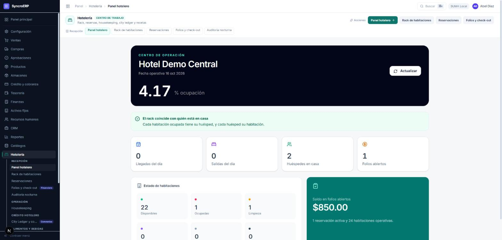
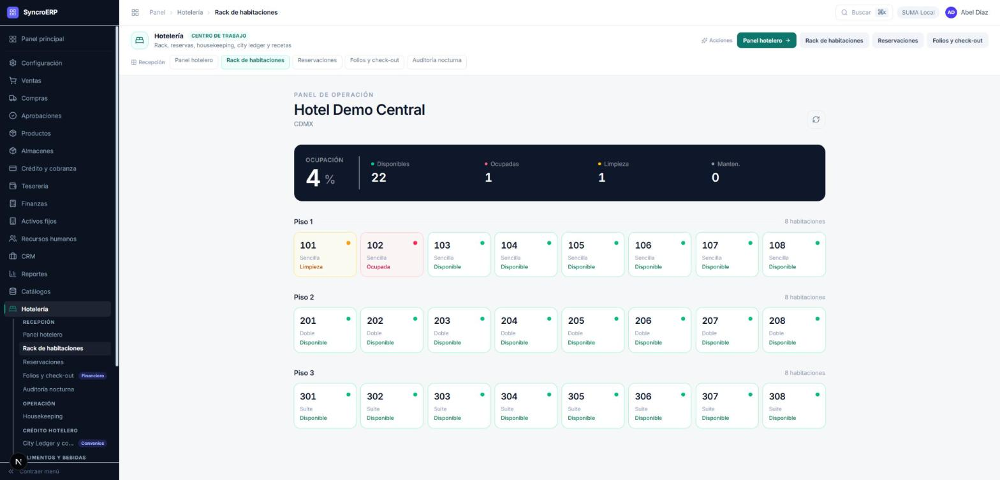
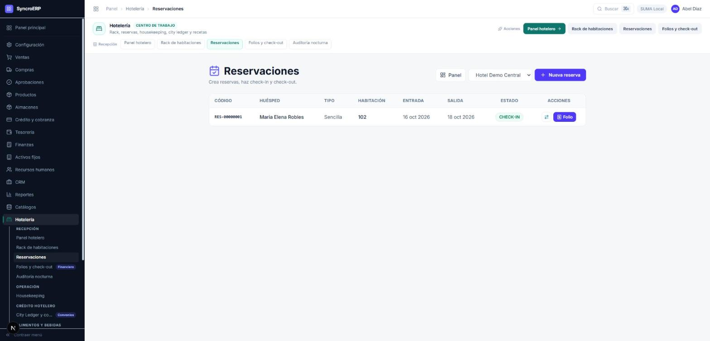
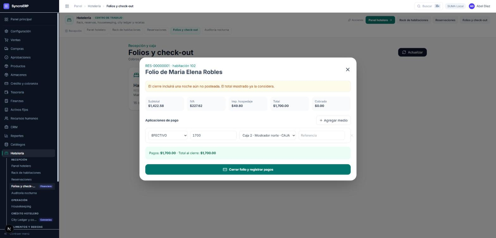
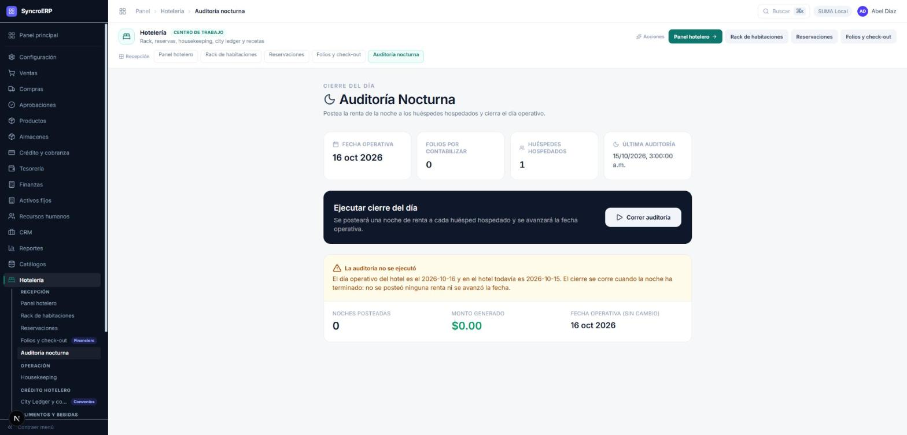
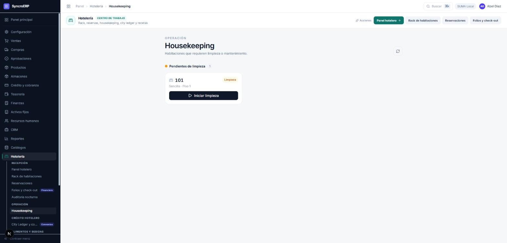

# 09 · Hotelería

**Revisión:** 15 de octubre de 2026
**Para:** recepción, ama de llaves, alimentos y bebidas, y quien lleva la caja
del hotel.

> **Recorrido de punta a punta el 15-oct-2026** contra el sistema corriendo:
> reserva, check-in, folio, auditoría nocturna y el rack, con las capturas de
> cada paso. Lo único que no se ejercitó aquí es el cobro del check-out, que
> mueve dinero a una caja.

---

## 1. Las once pantallas, y para qué es cada una

| Pantalla | Quién la usa | Para qué |
|---|---|---|
| **Panel hotelero** | Recepción, gerencia | El día de un vistazo: ocupación, llegadas, salidas, folios y saldo. |
| **Rack de habitaciones** | Recepción, ama de llaves | Dónde está cada habitación, piso por piso. |
| **Reservaciones** | Recepción | Crear reservas, hacer check-in, cambiar de habitación, cancelar. |
| **Folios y check-out** | Recepción y caja | La cuenta del huésped, los cobros y el cierre. |
| **Auditoría nocturna** | Recepción nocturna | Postear la renta de la noche y avanzar el día operativo. |
| **Housekeeping** | Ama de llaves | Qué hay que limpiar e inspeccionar, y quién lo hace. |
| **City Ledger** | Crédito y cobranza | Lo que se fue a crédito de un convenio, su antigüedad y su cobro. |
| **Recetas y escandallos** | Alimentos y bebidas | De qué insumos se compone cada platillo. |
| **Control de costos** | Alimentos y bebidas, finanzas | Lo que debió consumirse contra lo que salió del almacén. |
| **Configuración** | Administrador | Hoteles, tipos de habitación, tarifas, impuestos y dotación. |

---

## 2. La fecha operativa: el día del hotel no es el del calendario

Un hotel no cambia de día a medianoche: cambia cuando **corre la auditoría
nocturna**. Hasta entonces, la renta que se postea, el folio que se abre y la
noche que se cobra pertenecen al día anterior.

Por eso el hotel lleva su propia **fecha operativa**, y es la autoridad. El
panel la enseña arriba, y las llegadas y salidas que cuenta debajo son las de
**ese** día, no las del calendario.

> Hasta el 15-oct el panel rotulaba la fecha operativa y contaba las llegadas
> del calendario. Con las dos fechas iguales no se nota; se nota justo entre
> que corre la auditoría y llega la medianoche real, que es cuando recepción
> mira el panel.

---

## 3. El panel

Arriba, el porcentaje de ocupación sobre las habitaciones **operativas** —las
que no están en mantenimiento ni bloqueadas—, que es el número que se puede
vender.

Debajo, un aviso que compara dos cosas que ninguna otra pantalla comparaba:
**el rack contra quién está en casa**. Ver §4.

---

## 4. Una habitación ocupada por nadie

`OCUPADA` **no tiene salida manual, a propósito**: mientras haya alguien
dentro, la única forma de liberar una habitación es el check-out, que cierra su
folio y lo contabiliza. Ningún botón del rack se la salta.

Esa regla deja un caso sin salida: cuando la habitación figura ocupada y **no
hay nadie dentro** —una reservación borrada, un check-in a medias— no existe
check-out que hacer. La habitación se queda ocupada para siempre: no se puede
vender, y hasta el 15-oct nada en pantalla decía por qué.

**Medido el 15-oct** en el hotel de demostración: la 101, ocupada, con cero
huéspedes en casa y cero folios abiertos.

### Cómo se resuelve

El panel lo detecta y ofrece **Liberar**, que:

- sólo aparece cuando ninguna reservación en casa apunta a esa habitación, que
  es exactamente cuando el check-out es imposible;
- **la deja en limpieza, nunca en disponible**: lo que estuvo ocupado se limpia
  e inspecciona antes de volver a venderse, y eso lo sigue firmando el
  supervisor en su tarea de housekeeping;
- **pide el motivo por escrito** y lo guarda en la bitácora.

Con un huésped alojado contesta que no, y dice que el camino es el check-out.

El panel también avisa del caso contrario —alguien en casa cuya habitación no
figura ocupada—, pero ahí no ofrece botón: eso se arregla en recepción,
revisando el check-in.

---

## 5. El rack

Las habitaciones por piso, con su tipo y su estado. Los estados, y quién los
mueve:

| Estado | Qué significa | Cómo se sale |
|---|---|---|
| **Disponible** | Limpia y lista para vender. | Se bloquea o se manda a mantenimiento. |
| **Ocupada** | Huésped dentro. | **Sólo con el check-out** (§4). |
| **Limpieza** | Esperando a ama de llaves. | Con su tarea, no desde el rack. |
| **Inspección** | Limpia, esperando al supervisor. | Con su tarea, no desde el rack. |
| **Mantenimiento** | Fuera de servicio. | A disponible o a bloqueada. |
| **Bloqueada** | Retirada de la venta a propósito. | A disponible o a mantenimiento. |

> Limpieza e inspección avanzan **con sus tareas auditables** y no con un botón
> del rack: así nadie libera una habitación saltándose al supervisor.

---

## 6. Reservar

**Nueva reserva** pide huésped, tipo de habitación, entrada, salida, número de
huéspedes y la tarifa de la noche. Al elegir el tipo, **la tarifa se trae del
catálogo** —«Sencilla · $850/noche»— en vez de pedir que alguien la teclee: una
tarifa escrita a mano es una tarifa que puede salir en cero.

La reserva nace **CONFIRMADA**, sin habitación: el número se asigna en el
check-in, que es cuando se sabe cuál está lista.

La lista enseña la **habitación** junto al código. Quien está en el mostrador
busca por habitación —«el de la 102 pregunta por su cuenta»—, no por el folio
del documento.

### Cancelar

Sólo se cancela una reserva **confirmada**, y con motivo. Un huésped ya alojado
no se cancela: pasa por check-out.

---

## 7. Check-in

Se elige una de las habitaciones **disponibles del tipo reservado**. Las que
están en limpieza, inspección, mantenimiento o bloqueadas no se ofrecen.

En un solo movimiento, el check-in:

1. abre el **folio** del huésped;
2. postea **la primera noche** con su IVA y su impuesto de hospedaje;
3. descuenta la **dotación** de la habitación del inventario —amenidades,
   blancos—, y dice en pantalla lo que no alcanzó;
4. deja la habitación **ocupada** y la reserva en **CHECK-IN**.

---

## 8. El folio

| Renglón | Qué es |
|---|---|
| **Subtotal** | Los cargos sin impuestos. |
| **IVA** | Al tipo configurado del hotel. |
| **Imp. hospedaje** | El impuesto local sobre hospedaje. |
| **Total** | Lo que se debe al cierre. |
| **Cobrado** | Lo aplicado hasta ahora. |

> Si el hotel tiene configurado que **los precios incluyen impuestos**, la
> tarifa publicada es el total y los dos impuestos salen de dentro. Con
> $850/noche y dos noches: $1,700 de total, $1,422.58 de subtotal, $227.62 de
> IVA y $49.80 de hospedaje.

**«El cierre incluirá una noche aún no posteada. El total mostrado ya la
considera.»** El total que se ve es el del cierre, no el de los cargos ya
posteados: así nadie cobra de menos por una noche que la auditoría todavía no
había corrido.

### Cobrar

Se agregan tantos **medios de pago** como haga falta —efectivo, tarjeta,
transferencia, cheque, crédito de empresa, crédito de agencia— cada uno con su
cuenta o caja y su referencia. El renglón de abajo dice **cuánto suman los
pagos y cuánto es el total al cierre**: si no cuadran, se ve antes de pulsar.

**Cerrar folio y registrar pagos** hace el check-out: cierra el folio, registra
los cobros en tesorería, contabiliza y deja la habitación en **limpieza**.

Lo que se vaya a **crédito de un convenio** no se cobra aquí: pasa al City
Ledger (§10).

---

## 9. Auditoría nocturna

Cierra el día: postea una noche de renta a cada huésped hospedado y **avanza la
fecha operativa**.

**No se corre antes de tiempo.** Si el día operativo del hotel aún no termina,
la auditoría se niega y lo dice con todas sus letras —«el día operativo del
hotel es el 2026-10-16 y en el hotel todavía es 2026-10-15»—, con sus tres
números confirmando que nada se movió: **0 noches posteadas, $0.00, fecha
operativa sin cambio**.

> Esa negativa antes volvía con la misma forma que un cierre real —los mismos
> campos, todos en cero— y la pantalla sólo miraba que la llamada hubiera
> respondido. Quien la corría se iba creyendo que el día estaba cerrado.
> *El silencio contado como éxito.*

---

## 10. City Ledger

El crédito del hotel: lo que un convenio —una empresa, una agencia— se lleva
sin pagar en el mostrador.

| Pestaña | Qué tiene |
|---|---|
| **Cartera** | Cada saldo con su folio, emisión, vencimiento, antigüedad e IVA pendiente de reclasificar. |
| **Convenios** | Las empresas con crédito, su línea y su disponible. |
| **Auditoría histórica** | Qué se movió y cuándo. |
| **Estado de cuenta consolidado** | Lo que se le manda al convenio. |

Cada convenio **consume una sola línea maestra**: el crédito es del convenio,
no de cada folio suelto, y por eso el disponible baja en cuanto un folio se le
carga.

---

## 11. Housekeeping

Las habitaciones que esperan limpieza o mantenimiento, con su tarea. El ciclo
es **asignar camarista → iniciar → terminar → inspeccionar**, y cada paso queda
registrado con quién lo hizo.

Una habitación no vuelve a venderse por decisión de nadie: vuelve cuando su
tarea pasó por la inspección.

---

## 12. Alimentos y bebidas

**Recetas y escandallos** define de qué insumos se compone cada platillo o
bebida. Al venderse, esos insumos se descuentan del inventario, y el costo de
la receta se calcula de los costos vigentes.

**Control de costos** compara, en un período y por almacén:

| | |
|---|---|
| **Costo teórico** | Lo que debió consumirse según lo vendido. |
| **Costo real** | Lo que de verdad salió del almacén. |
| **Desviación** | La diferencia, en pesos y en porcentaje, por insumo. |

> «Salidas adicionales» son movimientos de esos mismos insumos que **no**
> vinieron del consumo de una receta: ajustes, mermas registradas y
> transferencias. Separarlas es lo que impide leer una merma como un robo.

---

## 13. Qué te va a negar el sistema

| Si intentas | Contesta |
|---|---|
| Hacer check-in en una habitación que no está disponible | «La habitación 101 no está disponible.» |
| Hacer check-in en una habitación de otro tipo u otro hotel | «La habitación no corresponde al hotel y tipo reservados.» |
| Hacer check-in dos veces | «La reservación ya tiene un folio.» |
| Cancelar una reserva de alguien ya alojado | «Sólo una reservación confirmada puede cancelarse. Un huésped alojado debe pasar por check-out.» |
| Correr la auditoría antes de que termine el día operativo | «El día operativo del hotel es el … y en el hotel todavía es …» |
| Liberar una habitación con huésped dentro | «La habitación 102 tiene un huésped alojado. Se libera con el check-out, que cierra su folio y lo contabiliza.» |
| Liberar una habitación que no está ocupada | «La habitación 101 no está ocupada: está en LIMPIEZA.» |
| Liberar sin escribir el motivo | Pide el motivo, y dice para qué sirve. |

---

## 14. Lo que falta

- **El cobro del check-out no se ha ejercitado de punta a punta** en este
  recorrido: mueve dinero a una caja y lo prueba quien opera. El folio queda
  abierto, con su habitación y su total, listo para cerrarse.
- El **control de costos** no se ha probado con un período que tenga consumo
  real de recetas.
- El catálogo de recetas del hotel de demostración tiene una sola receta, y no
  es un platillo: sirve para ver la pantalla, no para probar el costeo.
