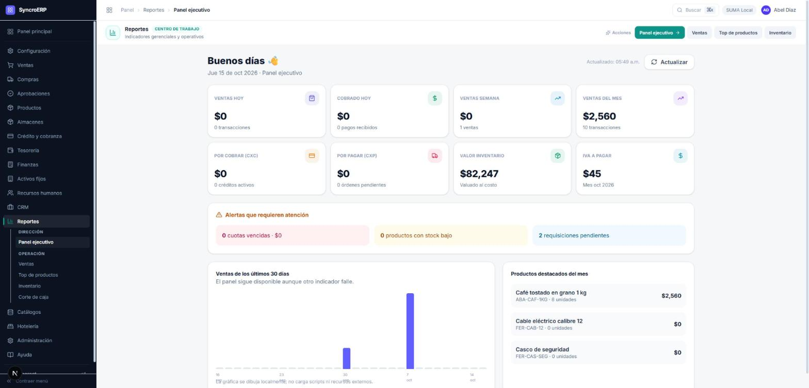
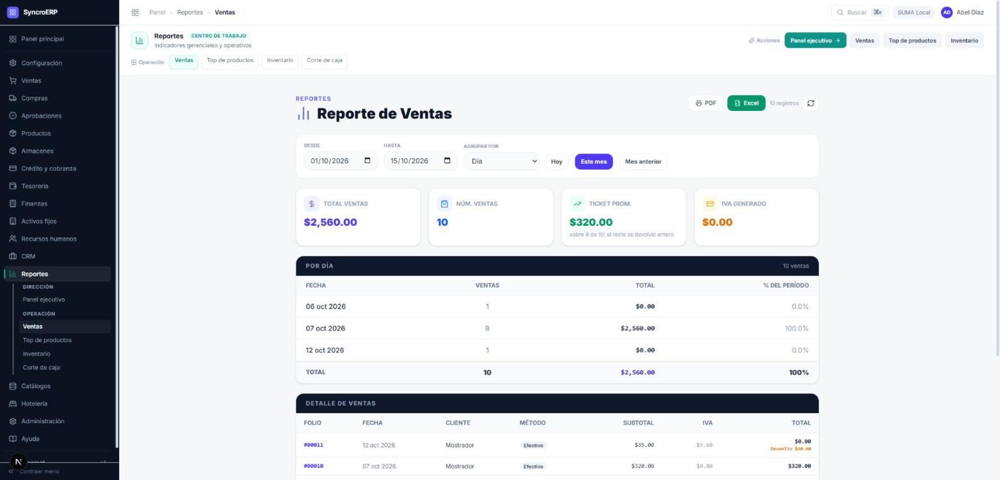

# 10 · Reportes

**Revisión:** 15 de octubre de 2026
**Para:** dirección, gerencia y quien cierra la caja.

> **Recorrido el 15-oct-2026** contra el sistema corriendo, con diez ventas de
> prueba. Lo que ese recorrido destapó está en §7.

---

## 1. Las siete pantallas

| Pantalla | Contesta |
|---|---|
| **Panel ejecutivo** | ¿Cómo va el negocio hoy, esta semana y este mes? |
| **Ventas** | ¿Qué se vendió en un período, y cómo se reparte? |
| **Top de productos** | ¿Qué se mueve? |
| **Inventario valorizado** | ¿Cuánto vale lo que hay en el almacén? |
| **Corte de caja** | ¿Qué entró hoy, y por qué medio? |
| **Estado de cuenta** | ¿Cuánto debe un cliente, y de qué? |

Todas se descargan en **PDF** y en **Excel**.

---

## 2. Panel ejecutivo

Ocho indicadores, tres alertas y dos cuadros.

| Indicador | De dónde sale |
|---|---|
| **Ventas hoy / semana / mes** | Ventas no anuladas, **netas de devoluciones**. |
| **Cobrado hoy** | Pagos recibidos, no ventas facturadas. |
| **Por cobrar (CxC)** | Las **dos** carteras: el crédito de ventas y el hospedaje a crédito del city ledger. |
| **Por pagar (CxP)** | Órdenes de compra pendientes. |
| **Valor inventario** | Valuado al costo. |
| **IVA a pagar** | Del mes en curso. |

> **Si una venta se devolvió entera, cuenta como transacción y suma cero.** Por
> eso «Ventas semana · $0 · 1 ventas» no es un error: hubo una venta y se
> devolvió. El número de transacciones dice lo que pasó; el importe, lo que
> quedó.

**Las alertas** —cuotas vencidas, productos bajo mínimo, requisiciones
pendientes— son las tres cosas que alguien tiene que resolver hoy, y llevan al
sitio donde se resuelven.

**La gráfica se dibuja localmente**: no carga scripts ni recursos externos. Y
el panel **sigue disponible aunque un indicador falle**: lo dice en pantalla en
vez de quedarse en blanco.

---

## 3. Reporte de ventas

Un período, tres formas de agruparlo —**por día, por método de pago, por
cliente**— y el detalle venta por venta debajo.

| Indicador | Qué cuenta |
|---|---|
| **Total ventas** | Neto de devoluciones, sin las anuladas. |
| **Núm. ventas** | Documentos del período, devueltos incluidos. |
| **Ticket promedio** | Sobre las ventas **que dejaron importe**, y lo dice al pie cuando no son todas. |
| **IVA generado** | Neto del IVA devuelto. |

En el detalle, una venta devuelta sale con **total $0.00** y el importe
devuelto en rojo debajo: no desaparece —ocurrió— pero no suma.

> El desglose por día y el detalle **leen la fecha de la misma manera**. Hasta
> el 15-oct no era así: el desglose agrupaba por el día UTC y el detalle
> enseñaba el día local, de modo que ocho ventas del 07 aparecían arriba como
> del 06. La suma cuadraba con el total, así que nada avisaba. Ver §7.

---

## 4. Top de productos

Los más vendidos de los **últimos 30 días**, por importe o por cantidad, netos
de devoluciones.

> **No se rellena.** Un producto que se vendió y se devolvió entero queda en
> cero y **no aparece**: si sólo un producto se movió, la lista trae uno. Una
> lista de lo más vendido con ceros dentro se lee como si esos productos se
> estuvieran moviendo.

Ojo con las ventanas al comparar: el panel ejecutivo destaca **el mes en
curso** y esta pantalla los **últimos 30 días**. Para el mismo producto pueden
dar números distintos, y los dos ser correctos.

---

## 5. Inventario valorizado

Stock actual × costo unitario, producto por producto, con su categoría, su
mínimo y su valor. Arriba: **valor total**, **total de unidades** y **cuántos
productos están bajo mínimo**, que es el número que dispara una reposición.

---

## 6. Corte de caja

Lo que entró en un día, por medio de pago —efectivo, tarjeta, transferencia,
cobranza— con el número de movimientos de cada uno y el detalle de ventas
debajo. Lleva la hora en que se generó, porque un corte es una foto.

---

## 7. Lo que el recorrido del 15-oct destapó

| Qué | Estado |
|---|---|
| El desglose por día ponía ocho ventas del 07-oct en el 06-oct: agrupaba por el día UTC y enseñaba el día local. | **Arreglado.** `diaDe` de `lib/fechas`, y un trinquete para que nadie vuelva a sacar el día partiendo la cadena. |
| El ticket promedio dividía entre documentos: diez ventas, dos devueltas enteras, promedio $256 cuando ninguna venta fue de $256 —las ocho que quedaron en pie eran de $320—. | **Arreglado.** Se calcula sobre las ventas con importe y lo dice al pie. |
| «Productos destacados» y «Top de productos» traían productos con cero unidades para rellenar renglones. | **Arreglado.** No salen de la consulta. |

---

## 8. Lo que falta

- El **estado de cuenta por cliente** no se ha ejercitado con un cliente que
  tenga crédito y abonos: hoy no hay créditos activos en los datos de prueba.
- El **corte de caja** no se ha probado contra un día con movimientos de varios
  medios de pago a la vez.
