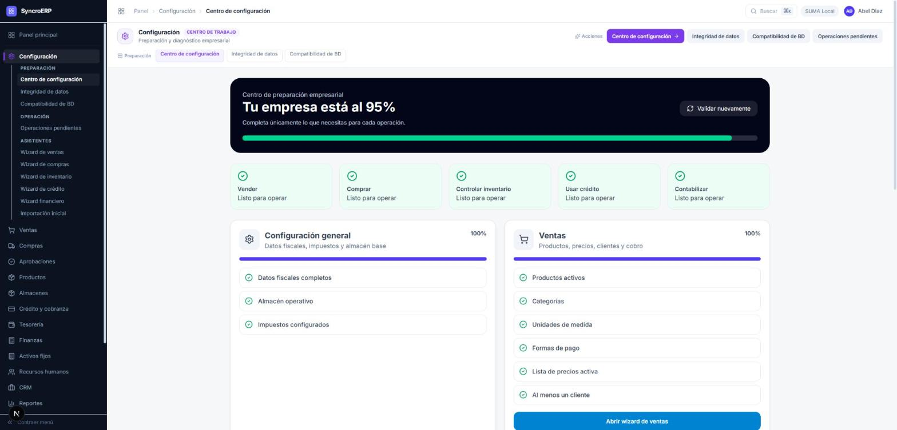
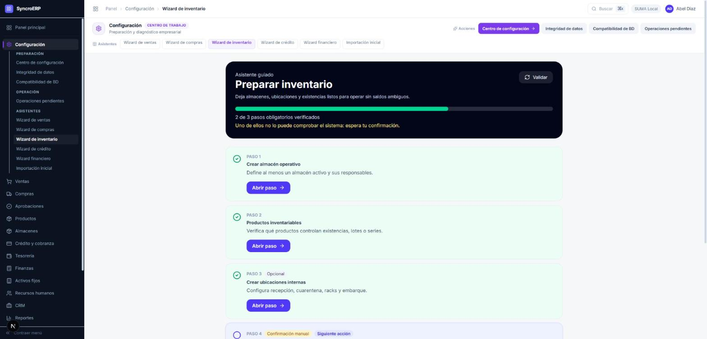

# 11 · Configuración y asistentes

**Revisión:** 15 de octubre de 2026
**Para:** quien pone una empresa en marcha, y quien la revisa después.

> Cada flujo de `07-flujos-y-procesos.md` empieza dando por hecho que este
> camino ya se recorrió. Aquí está el camino.

---

## 1. Centro de preparación

Una sola pantalla contesta **qué puede hacer ya esta empresa**, y lo contesta
midiendo, no preguntando: cada renglón es una consulta contra los datos reales.

Arriba, las **cinco operaciones**: vender, comprar, controlar inventario, usar
crédito y contabilizar. Cada una dice «listo para operar» o qué le falta.

Debajo, **siete áreas** con su porcentaje y sus requisitos uno por uno. Cada
requisito es un botón que lleva a la pantalla donde se resuelve: ningún
renglón te deja sabiendo que algo falta y sin saber dónde arreglarlo.

| Icono | Qué significa |
|---|---|
| Palomita verde | Hecho. |
| Cruz roja | Falta, y **bloquea** la operación de esa área. |
| Triángulo ámbar + **opcional** | Falta, y **no bloquea**. |

> Por eso «Usar crédito · Listo para operar» puede convivir con «Crédito y
> cobranza · 67 %»: lo que falta ahí no bloquea nada. Hasta el 15-oct eso sólo
> lo decía el color del icono, que es poco para resolver una contradicción
> aparente; ahora lo dice la palabra.

**Validar nuevamente** vuelve a medir. No guarda nada: pregunta otra vez.

---

## 2. Los seis asistentes

Cada área tiene su asistente, que es el mismo centro visto como una secuencia:
qué hacer primero, qué después, y qué es lo siguiente que falta.

| Asistente | Deja listo para | Termina en |
|---|---|---|
| **Ventas** | Vender en mostrador | Punto de venta |
| **Compras** | El ciclo de compra completo | Requisiciones |
| **Inventario** | Operar sin saldos ambiguos | Almacenes |
| **Crédito** | Dar crédito sin exceder exposición | Créditos |
| **Finanzas** | Cerrar períodos | Cuentas contables |
| **Importación inicial** | Cargar catálogos y saldos en orden | Importar |

### Lo que marca cada paso

| Etiqueta | Qué quiere decir |
|---|---|
| *(sin etiqueta)* | **Obligatorio**, y el sistema lo comprueba solo. |
| **Opcional** | Conviene, pero no detiene la operación. |
| **Confirmación manual** | Obligatorio, y **el sistema no lo puede comprobar**: lo declaras tú con «Ya realicé y revisé este paso». |
| **Siguiente acción** | Lo que toca ahora. |

> «Cargar la existencia inicial» y «realizar el conteo de apertura» son de
> confirmación manual porque **ningún dato distingue un almacén vacío de uno
> que todavía no se ha capturado**. El sistema podría ver cero existencias y
> darlo por bueno; no lo hace, porque un saldo inicial que nadie confirmó es la
> forma más cara de empezar a operar.

El botón de abajo no deja pasar a operar hasta que los pasos obligatorios
estén. Y cuando lo que falta es una confirmación tuya, **lo dice arriba**: así
el asistente no parece contradecir al centro, que sólo mide lo que se puede
medir.

---

## 3. El orden, cuando la empresa es nueva

1. **Configuración general** · datos fiscales, impuestos y almacén base.
2. **Importación inicial** · catálogos y saldos, en el orden que exige el
   propio asistente.
3. **Ventas**, **compras**, **inventario** · las tres operaciones de todos los
   días.
4. **Finanzas** · plan contable y bancos, antes del primer cierre.
5. **Crédito** · sólo si se va a dar crédito.

> Para una empresa recién dada de alta desde la consola SUMA, los catálogos de
> crédito ya vienen sembrados: ver `05-aprovisionamiento-y-consola-suma.md`.

---

## 4. Las otras tres pantallas de configuración

| Pantalla | Para qué |
|---|---|
| **Integridad de datos** | Comprueba que lo que está guardado es coherente consigo mismo. |
| **Compatibilidad de BD** | Que el esquema de la base coincide con el que el código espera. |
| **Operaciones pendientes** | Qué está pendiente, quién debe actuar y cuál es el siguiente paso. |

Las tres son **de lectura**: miden y dicen, no cambian nada.

---

## 5. Lo que falta

- Los asistentes de **crédito**, **finanzas** e **importación inicial** no se
  han recorrido paso a paso contra una empresa vacía; se verificó que cargan,
  que miden y que distinguen obligatorio de opcional.
- El recorrido completo sobre una **empresa recién creada** —no sobre la de
  demostración, que ya está al 95 %— sigue pendiente, y es el único que prueba
  el orden del §3 de verdad.
